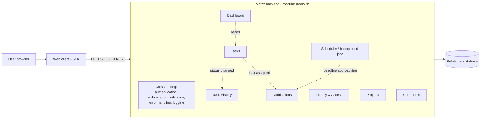

# Matriz — Architecture

> Part of the Matriz **Architecture Pack** (Aula 02). It builds on the
> Specification Pack (`requirements.md`, `user-stories.md`, `constraints.md`),
> which remains the source of truth for scope. No application code exists yet.
>
> Content is split into:
> - **Confirmed inputs** — taken from the Specification Pack (themselves still
>   subject to client validation, as stated in `constraints.md`).
> - **Decisions (proposed)** — design choices made in this phase, with
>   justification. They can be revisited.
> - **Assumptions / pending** — items that need confirmation before
>   implementation.

## 1. Inputs from the Specification Pack

- MVP scope: FR1–FR10 plus a simple, in-app-only FR11.
- Users are teams within an organization; roles: Administrator, Project Manager,
  Member (Viewer is future).
- Security: authentication required; authorization enforced **server-side**;
  users only see projects/tasks they are entitled to; hashed passwords;
  brute-force protection; no sensitive data in logs/errors; sessions invalid
  after sign-out; prefer soft delete (archive).
- Reliability: status and history changes are persisted consistently.
- Maintainability: the solution must be easy to evolve in the next phases.
- Concurrent edits must not silently overwrite changes.
- Non-functional targets (users, response times, volumes) are **not yet
  defined**; the technology stack is intentionally **open**.

## 2. Architectural alternatives (comparison for the MVP)

| Criterion | Monolith (unstructured) | **Modular monolith** | Microservices |
|-----------|-------------------------|----------------------|---------------|
| Deployment | One unit | One unit | Many independent units |
| Initial complexity | Lowest | Low | High (network, service discovery, distributed data) |
| Fit for a small team / MVP | Good | **Good** | Poor — overhead outweighs benefits |
| Internal boundaries | Weak; tends to "big ball of mud" | **Explicit modules with clear interfaces** | Strong (process/network boundaries) |
| Data consistency (status + history in one transaction) | Simple (single DB) | **Simple (single DB, ACID transactions)** | Hard (distributed transactions / eventual consistency) |
| Independent scaling | No | No (scale the whole unit) | Yes, per service |
| Evolution path | Costly refactoring later | **Modules can be extracted into services if ever needed** | Already distributed |
| Operational cost | Low | Low | High (monitoring, tracing, CI/CD per service) |

**Summary:**
- A plain **monolith** is the fastest to start but gives no guidance on
  boundaries, which hurts the *maintainability* requirement as features grow.
- **Microservices** solve scaling and team-autonomy problems Matriz does not
  have: there are no defined load targets, the domain is small and tightly
  related (tasks, comments, history and notifications all revolve around a
  task), and the "status change + history record" rule needs a single
  consistent transaction.
- A **modular monolith** keeps the simplicity of one deployable and one
  database while enforcing module boundaries that support future evolution.

## 3. Decision

**ADR-01 (proposed): Matriz MVP is a modular monolith** — a single backend
application exposing a REST API, organized into domain modules with explicit
interfaces, backed by a single relational database, and consumed by a web
client (browser).

Justification:
1. Matches the MVP goal "simple, usable, and deliverable".
2. A single database with ACID transactions satisfies the reliability
   requirement (a status change and its history entry are saved atomically).
3. Module boundaries satisfy maintainability and allow later extraction (e.g.
   Notifications) if real needs appear.
4. Low operational cost while hosting/deployment is still undefined.

Trade-offs accepted: no independent scaling per module; one deployment for
every change. Both are acceptable given the absence of defined load targets.

## 4. Components and responsibilities

| Component | Responsibilities | Requirements |
|-----------|------------------|--------------|
| **Web client (SPA)** | Screens (sign-in, project list, project dashboard, task detail), forms, client-side validation and warnings (e.g. past deadline), filter/sort controls, notification badge. Hides actions the user cannot perform — but never relies on this for security. | NFR Usability, all FRs |
| **Cross-cutting layer** | Authenticates every request; checks role/membership **server-side**; validates input; maps errors to a uniform format without leaking sensitive data; structured logging without secrets/PII. | NFR Security, Privacy |
| **Identity & Access** | Users, sign-in/sign-out, password hashing, session lifecycle, brute-force protection, platform role (Administrator). | FR1, US1 |
| **Projects** | Create/edit/archive projects, project status, membership and per-project role (Project Manager / Member); on member removal, unassigns their tasks in that project; prevents removing/demoting the owner without an ownership transfer. | FR2, exceptional case 2 |
| **Tasks** | Create/edit/assign tasks, status flow (To do / In progress / Done), priority, deadline, filtering & sorting, overdue computation, optimistic concurrency control. | FR3–FR6, FR9, exceptional cases 1 & 3 |
| **Task History** | Records each status change (previous status, new status, author, date) in the same transaction as the change; read-only listing. | FR10, US4 |
| **Comments** | Add and list comments on a task. | FR8, US8 |
| **Notifications** | Creates in-app notifications (task assigned, deadline approaching); lists them and marks them as read. | FR11, US11 |
| **Dashboard** | Read-only aggregation per project: task counts per status, % Done, overdue count; handles projects with no tasks. | FR7, FR9, exceptional case 4 |
| **Scheduler / background jobs** | Periodic job inside the same deployable that detects tasks approaching their deadline and asks Notifications to create alerts. | FR11 |
| **Relational database** | Single schema for all modules (see `database.md`). Each module owns its tables; other modules access them through the owning module's interface. | NFR Reliability |

Module rules:
- Modules communicate through in-process interfaces (function calls or
  in-process domain events), never by reading another module's tables directly.
- Domain events shown as dotted arrows are **in-process and synchronous**: the
  history entry and the `TASK_ASSIGNED` notification are written in the same
  database transaction as the task change, so neither can be lost.
- The deadline job is idempotent: at most one `DEADLINE_APPROACHING`
  notification per recipient, task and deadline (see `database.md`).

## 5. Key design decisions

| ID | Decision (proposed) | Justification | Related |
|----|---------------------|---------------|---------|
| ADR-01 | Modular monolith (see §3). | MVP simplicity, consistency, maintainability. | NFRs |
| ADR-02 | **REST API with JSON** over HTTPS, documented in OpenAPI 3.1 (`openapi.yaml`), path-versioned (`/api/v1`). | Simple, widely supported, contract-first for frontend/backend work. | All FRs |
| ADR-03 | **Single relational database.** | Data is highly relational (users–projects–tasks–comments–history) and needs ACID transactions. The specific engine stays open. | NFR Reliability; `constraints.md` pending "persistence approach" |
| ADR-04 | **Roles:** Administrator is a *platform-level* role on the user; Project Manager and Member are *per-project* roles stored in the membership. | Reconciles "Administrator manages the platform" with the assumption "one role per project". | `requirements.md` user types; `constraints.md` |
| ADR-05 | **Optimistic concurrency** on tasks using a `version` number; a stale update returns `409 Conflict` and the client reloads. | Implements exceptional case 3 without locks. | Exceptional case 3 |
| ADR-06 | **Derived values are computed, not stored:** "overdue" (deadline before today and status ≠ Done) and project progress (% Done). | Avoids stale flags and extra jobs; always consistent. | FR7, FR9, exceptional case 4 |
| ADR-07 | **Soft delete:** projects are archived (status `ARCHIVED`), not removed, in the MVP. | Security/privacy constraint "prefer soft delete". Narrows the Administrator permission "deleting projects" — pending confirmation (`database.md` P10). | FR2, `constraints.md` |
| ADR-08 | **Status change + history entry in one transaction.** | Reliability: history can never diverge from the task. | FR10, US4 |
| ADR-09 | **Authentication (proposal):** local accounts (email + password), passwords hashed with a slow adaptive algorithm (e.g. Argon2id/bcrypt), server-side sessions (stored in the database or a session store) referenced by an opaque, random ID in a `Secure`, `HttpOnly`, `SameSite=Lax` cookie; session ID regenerated at sign-in; idle and absolute expiry (values to define); deleted on sign-out; state-changing requests protected against CSRF (anti-CSRF token and/or `Origin` check); failed sign-ins rate-limited with temporary lockout. | Directly satisfies FR1 and every listed security constraint; server-side sessions make sign-out effective immediately. Still requires confirmation (see §6). | FR1, `constraints.md` security |
| ADR-10 | **Uniform error format** `application/problem+json` (RFC 9457) with generic messages. | Consistent client handling; no sensitive data in errors. | `constraints.md` security |
| ADR-11 | **Past deadline confirmation is enforced by the API:** a deadline earlier than today is rejected unless the request includes `confirmPastDeadline: true`. | Makes exceptional case 1 hold for any client, not only the web UI. | Exceptional case 1 |

## 6. Assumptions and pending decisions

Assumptions made in this phase (to validate):
- A1 — Expected load is small (a single organization with tens of users); a
  single instance is sufficient for the MVP.
- A2 — The web browser is the only client in the MVP (no mobile app).
- A3 — "Deadline approaching" means the deadline is today or tomorrow, in the
  organization time zone (threshold to be confirmed; consistent with
  date-only deadlines, A4).
- A4 — Deadlines are calendar dates; "today" is evaluated in a single
  organization time zone (to be confirmed).
- A5 — Users are created by an Administrator (no public self-registration),
  since the requirements only mention sign-in and account management by
  Administrators.
- A6 — FR6 "filter by deadline" is interpreted as a date range
  (`deadlineFrom` / `deadlineTo`) plus an "overdue only" shortcut.
- A7 — Session idle/absolute expiry values are not defined yet.

Data-model assumptions (P1–P11) are listed in `database.md` §5.

Still pending (from `constraints.md`, unchanged by this document):
- Technology stack (frontend framework, backend language/framework, database
  engine).
- Deployment and hosting environment.
- Authentication mechanism — ADR-09 is a proposal; an external identity
  provider remains an option.
- Password reset / account recovery (out of MVP scope).
- Testing strategy and tooling.

Resolved here as *proposals*: data model and persistence approach (ADR-03,
`database.md`) and concurrent-edit handling (ADR-05).

## 7. Related artifacts

- `docs/database.md` — data model and ER diagram.
- `openapi.yaml` — REST contract for selected MVP operations
  (list/filter tasks, create task, change task status). Other MVP operations
  are planned but not specified yet — notably a project summary endpoint
  (e.g. `GET /projects/{projectId}/summary`) returning counts per status,
  % Done, overdue and unassigned counts for the dashboard cards (FR7, FR9),
  which cannot be derived from the paginated task list.
- `docs/ui/wireframe.png` — low-fidelity wireframe of the project dashboard
  (source: `docs/ui/wireframe.html`).

## 8. Wireframe validation (project dashboard)

The dashboard was chosen because it concentrates most MVP features. Checked
against the Specification Pack:

| Wireframe element | MVP feature | Result |
|-------------------|-------------|--------|
| Navigation (Projects), user menu, Sign out | FR1, US1 | OK |
| Notifications with unread badge | FR11 (in-app only) | OK |
| Edit / Members / Archive (Managers only) | FR2, soft delete | OK |
| Progress bar (% Done) and counts per status | FR7, exceptional case 4 | OK — needs the planned summary endpoint (§7) |
| Overdue and unassigned counters, OVERDUE tags | FR9, exceptional case 2 | OK |
| Filters (status, priority, assignee, deadline range, overdue) and sort | FR6 | OK after review (deadline filter added) |
| "+ New task" (Managers only) | FR3, FR5, US3, exceptional case 1 | OK |
| Status dropdown per task | FR4, US4, exceptional case 3 | OK |
| Task detail (comments, history, edit priority/deadline) | FR5, FR8, FR10 | Annotated only; not drawn |

Nothing out of scope is shown (no Viewer role, attachments, subtasks, email,
import/export, or reports).

## 9. Critical review log 

Initial review by an independent agent with a fresh context window

| # | Finding | Decision | Action / rationale |
|---|---------|----------|--------------------|
| R1 | FR6 requires filtering by deadline; API/wireframe only had sorting and "overdue". | Accepted | Added `deadlineFrom`/`deadlineTo` to the API and a deadline filter to the wireframe (A6). |
| R2 | Owner/assignee membership invariants not enforced by the schema. | Partially accepted | Documented as invariant D9 enforced transactionally; composite FK left as an implementation option. Rejected redrawing the ER diagram (readability, logical model). |
| R3 | Deadline optionality and priority default chosen silently. | Accepted | Recorded as pending question P8; marked as proposed in the API. |
| R4 | Removing the owner/last Manager undefined. | Accepted | Added D10 (ownership transfer first). |
| R5 | Deadline reminders for unassigned tasks undefined. | Accepted | Added D12 and pending question P9. |
| R6 | Notifications could be lost after commit or duplicated by the job. | Partially accepted | Assignment notification now in the same transaction; uniqueness rule for deadline alerts. Rejected a transactional outbox as over-engineering for the MVP. |
| R7 | Session lifecycle and CSRF protection not specified. | Partially accepted | ADR-09 now covers storage, ID rotation, expiry, `SameSite=Lax`, CSRF. Rejected adding a Session entity to the logical model (D8); expiry values left pending (A7). |
| R8 | Wireframe did not show how priority/deadline are edited (FR5). | Accepted | Annotation updated (task detail). |
| R9 | Initial task `version` undefined while API requires ≥ 1. | Accepted | `version` starts at 1 in `database.md` and the API. |
| R10 | Wireframe privacy note omitted Administrators. | Accepted | Annotation updated. |
| R11 | `403` on the list operation contradicts the non-disclosing `404` rule. | Accepted | Removed `403` from `GET`; clarified 403 vs 404 on mutations. |
| R12 | Sort order of enum fields undefined. | Accepted | Semantic order documented in the API. |
| R13 | Assignee cardinality misstated in the relationship table. | Accepted | Corrected to "User 1 : 0..N Task; Task N : 0..1 User". |

Confirmed consistent by the review: status/priority enums, overdue definition,
history fields, atomic status + history, creation/status permissions, coverage
of exceptional cases 1–4, and no out-of-scope features.

### Review round 2

A second assisted review by the user who raised a few issues and upon discussion the following decisions were made:

| # | Finding | Action |
|---|---------|--------|
| R14 | Administrator "deleting projects" (requirements) vs archive-only (ADR-07/D7). | Cited `constraints.md` "prefer soft delete" and added pending question P10. |
| R15 | Wireframe rows not ordered by the selected "Deadline ↑" sort. | Rows reordered by deadline (no deadline last). |
| R16 | Dashboard cards have no API backing. | Documented a planned, not yet specified, summary endpoint (§7 and `openapi.yaml`). |
| R17 | Wireframe pagination (6 per page) vs API default `pageSize` 25. | Wireframe now states page size 25 and that rows are omitted in the sketch. |
| R18 | `PATCH` to the current status undefined. | Returns `422 STATUS_UNCHANGED`; nothing is changed or recorded. |
| R19 | A3 "next 24 hours" conflicts with date-only deadlines. | A3 rephrased as "today or tomorrow (organization time zone)". |
| R20 | Tasks of deactivated users undefined. | Added pending question P11. |
| R21 | Assignee sort key unspecified; "Me" not an API value; BR10 "Administrators see all" labelled as confirmed. | Assignee sort = by name, unassigned last; "Me" mapped by the client to the user's id; Administrator visibility moved to decision D13. |
