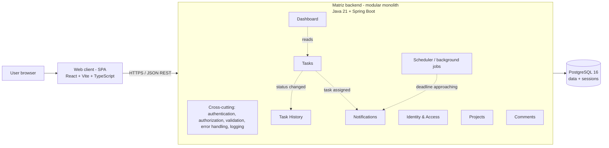

# Matriz — Architecture

> Part of the Matriz **Architecture Pack** (Aula 02). It builds on the
> Specification Pack (`requirements.md`, `user-stories.md`, `constraints.md`),
> which remains the source of truth for scope. No application code exists yet.
>
> Content is split into:
> - **Confirmed inputs** — taken from the Specification Pack (themselves still
>   subject to client validation, as stated in `constraints.md`).
> - **Decisions** — design choices recorded as ADRs in [`docs/adr/`](adr/README.md),
>   with justification. Proposed decisions can be revisited.
> - **Assumptions / pending** — items that need confirmation before
>   implementation.

## 1. Inputs from the Specification Pack

- MVP scope: FR1–FR10 plus a simple, in-app-only FR11.
- Users are teams within an organization; roles: Administrator, Project Manager,
  Member (Viewer is future).
- Security: authentication required; authorization enforced **server-side**;
  users only see projects/tasks they are entitled to; hashed passwords;
  brute-force protection; no sensitive data in logs/errors; sessions invalid
  after sign-out; prefer soft delete (archive).
- Reliability: status and history changes are persisted consistently.
- Maintainability: the solution must be easy to evolve in the next phases.
- Concurrent edits must not silently overwrite changes.
- Non-functional targets (quantified — see `requirements.md`):
  - 5,000 users, all of whom may be concurrent; estimated peak ~300–500
    requests/s, including notification polling every 30–60 s.
  - p95 server-side (excluding network) < 200 ms for lists/dashboard and
    < 500 ms for writes.
  - Data after year 1: ~5k projects, ~500k tasks, ~2M comments; growth ~2× in
    2 years (≈ 10k users).
  - ~99% availability during business hours; single instance, single region;
    brief downtime for deploys acceptable; no real-time updates (refresh /
    polling is fine).
  - Users are spread across regions: dates are evaluated in each user's time
    zone.

## 2. Architectural style

Three styles were compared for the MVP — unstructured monolith, **modular
monolith** and microservices. The full comparison (deployment, complexity,
boundaries, data consistency, scaling, evolution, operational cost) and the
pros and cons of each option are recorded in
[ADR-0001](adr/0001-modular-monolith.md).

### 2.1 Technology stack

Chosen in [ADR-0012](adr/0012-technology-stack.md) (accepted), which records
the full debate — every option per layer with its pros and cons against the
requirements above:

| Layer | Choice | Main alternatives considered |
|-------|--------|------------------------------|
| Backend | Java 21 + Spring Boot (Web MVC, Spring Security, Spring Session JDBC, Spring Modulith, `@Scheduled`), virtual threads, HikariCP | Rust + Axum, TypeScript + Fastify, Python + FastAPI |
| Frontend | React + Vite + TypeScript SPA, TanStack Query, typed client generated from `openapi.yaml`, `Intl` / `date-fns-tz` | Angular, Vue + Vite, server-rendered Thymeleaf |
| Database | PostgreSQL 16 (Docker Compose); also stores HTTP sessions (no Redis) | SQLite |
| Persistence | Spring Data JPA (Hibernate) with `@Version`, DTO projections / fetch joins on reads; Flyway (plain SQL) | jOOQ, JPA + JDBC hybrid; Liquibase |
| Tests | JUnit 5, Spring Boot Test, MockMvc, Testcontainers (PostgreSQL); Vitest + React Testing Library; k6 for p95 | H2 in-memory |
| Build | Maven with wrapper (`./mvnw`) | Gradle (Kotlin DSL) |

Why, in short: the workload is database-bound, so every backend option meets
the load on one instance; Java + Spring Boot wins on security (ADR-0009 by
configuration), enforceable module boundaries (ADR-0001), transactions and
optimistic locking (ADR-0005, ADR-0008), reproducibility with the installed
toolchain, and an easy path to multiple instances later.

## 3. Decision

[ADR-0001](adr/0001-modular-monolith.md) (proposed): **Matriz MVP is a
modular monolith** — a single backend application exposing a REST API,
organized into domain modules with explicit interfaces, backed by a single
relational database (PostgreSQL 16), and consumed by a web client (browser).
Justification, trade-offs and confirmation are in the ADR.

## 4. Components and responsibilities

| Component | Responsibilities | Requirements |
|-----------|------------------|--------------|
| **Web client (SPA)** — React + Vite + TypeScript, TanStack Query | Screens (sign-in, project list, project dashboard, task detail), forms, client-side validation and warnings (e.g. past deadline), filter/sort controls, notification badge (polled every 30–60 s); dates shown in the user's time zone. Hides actions the user cannot perform — but never relies on this for security. | NFR Usability, all FRs |
| **Cross-cutting layer** — Spring Security, Bean Validation, `ProblemDetail` | Authenticates every request; checks role/membership **server-side**; validates input; maps errors to a uniform format without leaking sensitive data; structured logging without secrets/PII. | NFR Security, Privacy |
| **Identity & Access** — Spring Security (Argon2id), Spring Session JDBC | Users, sign-in/sign-out, password hashing, session lifecycle, brute-force protection, platform role (Administrator). | FR1, US1 |
| **Projects** | Create/edit/archive projects, project status, membership and per-project role (Project Manager / Member); on member removal, unassigns their tasks in that project; prevents removing/demoting the owner without an ownership transfer. | FR2, exceptional case 2 |
| **Tasks** | Create/edit/assign tasks, status flow (To do / In progress / Done), priority, deadline, filtering & sorting, overdue computation, optimistic concurrency control. | FR3–FR6, FR9, exceptional cases 1 & 3 |
| **Task History** | Records each status change (previous status, new status, author, date) in the same transaction as the change; read-only listing. | FR10, US4 |
| **Comments** | Add and list comments on a task. | FR8, US8 |
| **Notifications** | Creates in-app notifications (task assigned, deadline approaching); lists them and marks them as read. | FR11, US11 |
| **Dashboard** | Read-only aggregation per project: task counts per status, % Done, overdue count; handles projects with no tasks. | FR7, FR9, exceptional case 4 |
| **Scheduler / background jobs** — Spring `@Scheduled` | Periodic job inside the same deployable that detects tasks approaching their deadline and asks Notifications to create alerts. | FR11 |
| **Relational database** — PostgreSQL 16, Flyway migrations | Single schema for all modules (see `database.md`); also stores HTTP sessions. Each module owns its tables; other modules access them through the owning module's interface. | NFR Reliability |

Module rules:
- Modules communicate through in-process interfaces (function calls or
  in-process domain events), never by reading another module's tables directly.
  Boundaries are verified by a Spring Modulith test (ADR-0012).
- Domain events shown as dotted arrows are **in-process and synchronous**: the
  history entry and the `TASK_ASSIGNED` notification are written in the same
  database transaction as the task change, so neither can be lost.
- The deadline job is idempotent: at most one `DEADLINE_APPROACHING`
  notification per recipient, task and deadline (see `database.md`).

## 5. Key design decisions

All architecture decisions are recorded as ADRs (MADR 4.0) in
[`docs/adr/`](adr/README.md). Each ADR has its context, decision drivers,
considered options with pros and cons, consequences and confirmation.

| ID | Decision | Status |
|----|----------|--------|
| [ADR-0001](adr/0001-modular-monolith.md) | Modular monolith | proposed |
| [ADR-0002](adr/0002-rest-json-api-openapi.md) | REST API with JSON, OpenAPI 3.1, `/api/v1` | proposed |
| [ADR-0003](adr/0003-single-relational-database.md) | Single relational database | proposed |
| [ADR-0004](adr/0004-platform-and-project-roles.md) | Platform Administrator; per-project Project Manager / Member | proposed |
| [ADR-0005](adr/0005-optimistic-concurrency-for-tasks.md) | Optimistic concurrency on tasks (`version`, `409`) | proposed |
| [ADR-0006](adr/0006-compute-derived-values.md) | Derived values (overdue, % Done) computed, not stored | proposed |
| [ADR-0007](adr/0007-soft-delete-projects.md) | Soft delete: projects archived | proposed |
| [ADR-0008](adr/0008-status-change-and-history-in-one-transaction.md) | Status change + history entry in one transaction | proposed |
| [ADR-0009](adr/0009-authentication-server-side-sessions.md) | Local accounts + server-side sessions, CSRF, lockout | proposed |
| [ADR-0010](adr/0010-uniform-error-format-problem-json.md) | `application/problem+json` errors | proposed |
| [ADR-0011](adr/0011-past-deadline-confirmation-enforced-by-api.md) | Past deadline confirmation enforced by the API | proposed |
| [ADR-0012](adr/0012-technology-stack.md) | Technology stack | accepted |

IDs ADR-01 … ADR-11 used elsewhere in the documentation correspond to
ADR-0001 … ADR-0011.

## 6. Assumptions and pending decisions

Assumptions made in this phase (to validate):
- A1 — *Superseded by the quantified targets in §1 and `requirements.md`*
  (originally: "expected load is small, tens of users"). A single instance is
  still sufficient: 5,000 users, peak ~300–500 req/s, single region
  ([ADR-0012](adr/0012-technology-stack.md)).
- A2 — The web browser is the only client in the MVP (no mobile app).
- A3 — "Deadline approaching" means the deadline is today or tomorrow, in the
  **recipient's time zone** (threshold to be confirmed; consistent with
  date-only deadlines, A4). The deadline job therefore runs periodically
  (e.g. hourly) rather than once per day.
- A4 — Deadlines are calendar dates; "today" (overdue, past-deadline check,
  deadline approaching) is evaluated in **each user's time zone**, because
  users are spread across regions (revised; previously a single organization
  time zone). This needs a time-zone attribute on the user, still to be added
  to `database.md`.
- A5 — Users are created by an Administrator (no public self-registration),
  since the requirements only mention sign-in and account management by
  Administrators.
- A6 — FR6 "filter by deadline" is interpreted as a date range
  (`deadlineFrom` / `deadlineTo`) plus an "overdue only" shortcut.
- A7 — Session idle/absolute expiry values are not defined yet.

Data-model assumptions (P1–P11) are listed in `database.md` §5.

Still pending (from `constraints.md`):
- Deployment and hosting environment.
- Authentication mechanism — [ADR-0009](adr/0009-authentication-server-side-sessions.md)
  is a proposal; an external identity provider remains an option.
- Password reset / account recovery (out of MVP scope).

Resolved: technology stack and testing strategy
([ADR-0012](adr/0012-technology-stack.md), accepted). Resolved as
*proposals*: data model and persistence approach
([ADR-0003](adr/0003-single-relational-database.md), `database.md`) and
concurrent-edit handling ([ADR-0005](adr/0005-optimistic-concurrency-for-tasks.md)).

## 7. Related artifacts

- [`docs/adr/`](adr/README.md) — Architecture Decision Records (ADR-0001 …
  ADR-0012).
- `docs/database.md` — data model and ER diagram.
- `openapi.yaml` — REST contract for selected MVP operations
  (list/filter tasks, create task, change task status). Other MVP operations
  are planned but not specified yet — notably a project summary endpoint
  (e.g. `GET /projects/{projectId}/summary`) returning counts per status,
  % Done, overdue and unassigned counts for the dashboard cards (FR7, FR9),
  which cannot be derived from the paginated task list.
- `docs/ui/wireframe.png` — low-fidelity wireframe of the project dashboard
  (source: `docs/ui/wireframe.html`).

## 8. Wireframe validation (project dashboard)

The dashboard was chosen because it concentrates most MVP features. Checked
against the Specification Pack:

| Wireframe element | MVP feature | Result |
|-------------------|-------------|--------|
| Navigation (Projects), user menu, Sign out | FR1, US1 | OK |
| Notifications with unread badge | FR11 (in-app only) | OK |
| Edit / Members / Archive (Managers only) | FR2, soft delete | OK |
| Progress bar (% Done) and counts per status | FR7, exceptional case 4 | OK — needs the planned summary endpoint (§7) |
| Overdue and unassigned counters, OVERDUE tags | FR9, exceptional case 2 | OK |
| Filters (status, priority, assignee, deadline range, overdue) and sort | FR6 | OK after review (deadline filter added) |
| "+ New task" (Managers only) | FR3, FR5, US3, exceptional case 1 | OK |
| Status dropdown per task | FR4, US4, exceptional case 3 | OK |
| Task detail (comments, history, edit priority/deadline) | FR5, FR8, FR10 | Annotated only; not drawn |

Nothing out of scope is shown (no Viewer role, attachments, subtasks, email,
import/export, or reports).

## 9. Critical review log 

Initial review by an independent agent with a fresh context window

| # | Finding | Decision | Action / rationale |
|---|---------|----------|--------------------|
| R1 | FR6 requires filtering by deadline; API/wireframe only had sorting and "overdue". | Accepted | Added `deadlineFrom`/`deadlineTo` to the API and a deadline filter to the wireframe (A6). |
| R2 | Owner/assignee membership invariants not enforced by the schema. | Partially accepted | Documented as invariant D9 enforced transactionally; composite FK left as an implementation option. Rejected redrawing the ER diagram (readability, logical model). |
| R3 | Deadline optionality and priority default chosen silently. | Accepted | Recorded as pending question P8; marked as proposed in the API. |
| R4 | Removing the owner/last Manager undefined. | Accepted | Added D10 (ownership transfer first). |
| R5 | Deadline reminders for unassigned tasks undefined. | Accepted | Added D12 and pending question P9. |
| R6 | Notifications could be lost after commit or duplicated by the job. | Partially accepted | Assignment notification now in the same transaction; uniqueness rule for deadline alerts. Rejected a transactional outbox as over-engineering for the MVP. |
| R7 | Session lifecycle and CSRF protection not specified. | Partially accepted | ADR-09 now covers storage, ID rotation, expiry, `SameSite=Lax`, CSRF. Rejected adding a Session entity to the logical model (D8); expiry values left pending (A7). |
| R8 | Wireframe did not show how priority/deadline are edited (FR5). | Accepted | Annotation updated (task detail). |
| R9 | Initial task `version` undefined while API requires ≥ 1. | Accepted | `version` starts at 1 in `database.md` and the API. |
| R10 | Wireframe privacy note omitted Administrators. | Accepted | Annotation updated. |
| R11 | `403` on the list operation contradicts the non-disclosing `404` rule. | Accepted | Removed `403` from `GET`; clarified 403 vs 404 on mutations. |
| R12 | Sort order of enum fields undefined. | Accepted | Semantic order documented in the API. |
| R13 | Assignee cardinality misstated in the relationship table. | Accepted | Corrected to "User 1 : 0..N Task; Task N : 0..1 User". |

Confirmed consistent by the review: status/priority enums, overdue definition,
history fields, atomic status + history, creation/status permissions, coverage
of exceptional cases 1–4, and no out-of-scope features.

### Review round 2

A second assisted review by the user who raised a few issues and upon discussion the following decisions were made:

| # | Finding | Action |
|---|---------|--------|
| R14 | Administrator "deleting projects" (requirements) vs archive-only (ADR-07/D7). | Cited `constraints.md` "prefer soft delete" and added pending question P10. |
| R15 | Wireframe rows not ordered by the selected "Deadline ↑" sort. | Rows reordered by deadline (no deadline last). |
| R16 | Dashboard cards have no API backing. | Documented a planned, not yet specified, summary endpoint (§7 and `openapi.yaml`). |
| R17 | Wireframe pagination (6 per page) vs API default `pageSize` 25. | Wireframe now states page size 25 and that rows are omitted in the sketch. |
| R18 | `PATCH` to the current status undefined. | Returns `422 STATUS_UNCHANGED`; nothing is changed or recorded. |
| R19 | A3 "next 24 hours" conflicts with date-only deadlines. | A3 rephrased as "today or tomorrow (organization time zone)". |
| R20 | Tasks of deactivated users undefined. | Added pending question P11. |
| R21 | Assignee sort key unspecified; "Me" not an API value; BR10 "Administrators see all" labelled as confirmed. | Assignee sort = by name, unassigned last; "Me" mapped by the client to the user's id; Administrator visibility moved to decision D13. |
