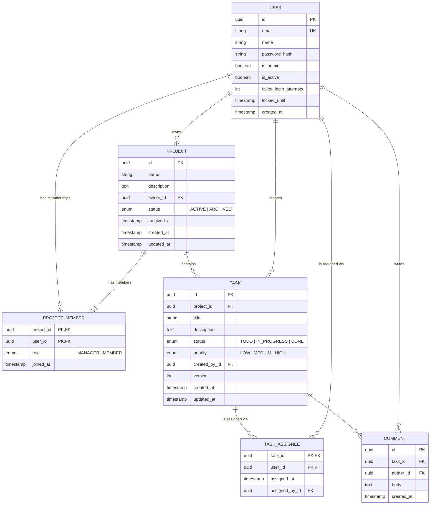

# Matriz — Data Model

> Part of the Matriz **Architecture Pack**, consolidated for the **release 1
> MVP scope** (see [`implementation-plan.md`](implementation-plan.md)).
> Derived from `requirements.md`, `user-stories.md`, and `constraints.md`;
> architectural context in `architecture.md`
> ([ADR-0003](adr/0003-single-relational-database.md): single relational
> database). The database engine is **PostgreSQL 16**
> ([ADR-0012](adr/0012-technology-stack.md)); types below are logical and are
> mapped to PostgreSQL types in the Flyway migrations (Increment 2).
>
> Labels: **Confirmed** = decided with the user (client representative); **Proposed** =
> decided by the agent within the delegated scope, can be revisited;
> **Deferred** = kept for a later phase, not implemented in release 1.

## 1. Entities (summary)

| Entity | Purpose | Source | Release 1 |
|--------|---------|--------|----------|
| **User** | A person who signs in; may be a platform Administrator. | FR1, user types | In scope |
| **Project** | A body of work with members and tasks; archived instead of deleted. | FR2 | In scope |
| **ProjectMember** | Membership of a user in a project, with the per-project role (Project Manager or Member). | FR2, assumption "one role per project" | In scope |
| **Task** | Unit of work inside a project, with status and priority. | FR3–FR6 | In scope |
| **TaskAssignee** | Assignment of a user to a task (many-to-many). | FR3, release 1 (several assignees) | In scope (new) |
| **Comment** | Text added by a user to a task. | FR8 | In scope |
| **TaskStatusChange** | History record of a task status change. | FR10 | **Deferred** |
| **Notification** | In-app alert for a user. | FR11 | **Deferred** |

HTTP sessions are stored by Spring Session JDBC in its own tables
(`SPRING_SESSION`, `SPRING_SESSION_ATTRIBUTES`), created by a Flyway
migration; they are an implementation detail and not part of the logical
model (D8).

## 2. Attributes and identifiers

Conventions: every entity has a surrogate primary key `id` (UUID) unless
stated otherwise. `PK` = primary key, `FK` = foreign key, `UK` = unique.
Timestamps are stored in UTC (`timestamptz`). Text inputs are trimmed by the
backend; length limits apply to the trimmed value and whitespace-only values
are rejected (Confirmed).

### User
| Attribute | Type | Rules |
|-----------|------|-------|
| id | UUID | PK |
| email | string | UK (case-insensitive, e.g. unique index on `lower(email)`), required, ≤ 254 |
| name | string | required |
| password_hash | string | required; Argon2id hash only, never plain text |
| is_admin | boolean | default `false` (platform Administrator — [ADR-0004](adr/0004-platform-and-project-roles.md)) |
| is_active | boolean | default `true`; inactive users cannot sign in and lose an open session on their next request |
| failed_login_attempts | integer | default 0; reset on successful sign-in |
| locked_until | timestamp | nullable; set to now + 15 min after 5 consecutive failures |
| created_at | timestamp | required |

Users are created only by the demo seed in release 1 (no public registration,
no password reset, no admin UI — Confirmed). *Deferred:* `time_zone` (IANA
zone ID, ADR-0012 DD6) — only needed for deadlines.

### Project
| Attribute | Type | Rules |
|-----------|------|-------|
| id | UUID | PK |
| name | string | required, 3–100 chars (Confirmed) |
| description | text | optional, ≤ 1000 chars (Confirmed) |
| owner_id | UUID | FK → User; required; the creator; always a `MANAGER` member; immutable in release 1 (PR3) |
| status | enum `ACTIVE`, `ARCHIVED` | default `ACTIVE`; archive replaces delete ([ADR-0007](adr/0007-soft-delete-projects.md)) |
| archived_at | timestamp | nullable; set when archived, cleared when unarchived |
| created_at / updated_at | timestamp | required |

*Deferred:* `start_date`, `expected_end_date` (with `expected_end_date ≥
start_date`).

### ProjectMember
| Attribute | Type | Rules |
|-----------|------|-------|
| project_id | UUID | PK (part), FK → Project |
| user_id | UUID | PK (part), FK → User |
| role | enum `MANAGER`, `MEMBER` | required; one role per user per project |
| joined_at | timestamp | required |

### Task
| Attribute | Type | Rules |
|-----------|------|-------|
| id | UUID | PK |
| project_id | UUID | FK → Project; required |
| title | string | required, 3–150 chars (Confirmed) |
| description | text | optional, ≤ 2000 chars (Confirmed) |
| status | enum `TODO`, `IN_PROGRESS`, `DONE` | required; initial value `TODO` |
| priority | enum `LOW`, `MEDIUM`, `HIGH` | required; default `MEDIUM` |
| created_by_id | UUID | FK → User; required; inferred from the session |
| version | integer | required; starts at 1; incremented on every task update ([ADR-0005](adr/0005-optimistic-concurrency-for-tasks.md)) |
| created_at / updated_at | timestamp | required |

Removed from the Architecture Pack model: `assignee_id` (replaced by TaskAssignee,
[ADR-0013](adr/0013-multiple-assignees-per-task.md)). *Deferred:* `deadline`
and the derived `is_overdue` (FR5 deadline part, FR9).

Derived (not stored, [ADR-0006](adr/0006-compute-derived-values.md)):
- `unassigned` = the task has no TaskAssignee rows.
- Project progress `% Done` = `floor(100 × DONE / total)`, `0` when there are
  no tasks (exceptional case 4).

### TaskAssignee
| Attribute | Type | Rules |
|-----------|------|-------|
| task_id | UUID | PK (part), FK → Task `ON DELETE CASCADE` |
| user_id | UUID | PK (part), FK → User |
| assigned_at | timestamp | required |
| assigned_by_id | UUID | FK → User; required; inferred from the session |

The composite PK (`task_id`, `user_id`) guarantees no duplicate assignment
(Confirmed). The user must be a member of the task's project (D9).

### Comment
| Attribute | Type | Rules |
|-----------|------|-------|
| id | UUID | PK |
| task_id | UUID | FK → Task `ON DELETE CASCADE`; required |
| author_id | UUID | FK → User; required; inferred from the session |
| body | text | required, 1–2000 chars (Confirmed) |
| created_at | timestamp | required; set by the backend |

Comments are immutable (no edit, no delete — Confirmed).

### Deferred entities (kept for a later phase)

**TaskStatusChange** (FR10, [ADR-0008](adr/0008-status-change-and-history-in-one-transaction.md)):
`id` PK, `task_id` FK, `changed_by_id` FK, `from_status`, `to_status`
(`≠ from_status`), `changed_at`; append-only, written in the same transaction
as the status change.

**Notification** (FR11): `id` PK, `recipient_id` FK, `task_id` FK, `type`
(`TASK_ASSIGNED`, `DEADLINE_APPROACHING`), `message` (no sensitive data),
`is_read`, `created_at`. The Architecture Pack uniqueness rule for deadline reminders
(per recipient, task and deadline value) depends on the deferred `deadline`
column and will be revisited together with deadlines.

## 3. Relationships and cardinalities

| Relationship | Cardinality | Notes |
|--------------|-------------|-------|
| User — ProjectMember — Project | User 1 : 0..N ProjectMember; Project 1 : 1..N ProjectMember | A project always has its owner as `MANAGER` member. |
| User **owns** Project | User 1 : 0..N Project; Project N : 1 User | `owner_id`. |
| Project **contains** Task | Project 1 : 0..N Task; Task N : 1 Project | A task belongs to exactly one project. |
| User — TaskAssignee — Task | User 1 : 0..N TaskAssignee; Task 1 : 0..N TaskAssignee | Many-to-many; 0..N assignees per task. |
| User **creates** Task | User 1 : 0..N Task | `created_by_id`. |
| Task **has** Comment | Task 1 : 0..N Comment | Cascade on task delete. |
| User **writes** Comment | User 1 : 0..N Comment | |

## 4. ER diagram (Mermaid)

> The PNG below (`er_diagram.png`) shows the **Architecture Pack** model (single
> assignee, deadlines, history, notifications) and is kept for reference; the
> Mermaid diagram is the current model.

Deferred entities (TaskStatusChange, Notification) are intentionally not
drawn; see §2 "Deferred entities".

## 5. Business rules

Confirmed (Specification Pack and release 1 decisions with the user):
- BR1 — A new task starts in `TODO`, priority defaults to `MEDIUM`, and has a
  title of 3–150 chars; it may have **0..N** assignees at creation
  (relaxed from Architecture Pack "requires an assignee").
- BR2 — Status values are `TODO`, `IN_PROGRESS`, `DONE`; any transition is
  allowed (FR4).
- BR3 — Project Managers of the project (and Administrators) create, edit,
  delete and assign tasks; a task's assignees can edit its title,
  description, status and priority; other members can only read and comment
  (FR3–FR5, US4).
- BR4 — *Deferred* (FR10): every status change creates a TaskStatusChange.
- BR5 — *Deferred* (FR9): overdue flagging.
- BR6 — Project progress = tasks `DONE` / total tasks; a project with no tasks
  shows 0% / "no tasks" (FR7, exceptional case 4). Counts are computed in SQL
  over all tasks, not over a page.
- BR7 — Removing a member deletes their assignments on tasks of that project
  in the same transaction; tasks and comments are kept (exceptional case 2,
  adapted to N:M — Proposed PR5).
- BR8 — A stale task update (version mismatch) is rejected with `409`
  (exceptional case 3).
- BR9 — *Deferred* (exceptional case 1): past-deadline confirmation.
- BR10 — Users only see projects they are members of; Administrators see and
  manage all projects (NFR Privacy, D13 — Confirmed).
- BR11 — Any signed-in user can create a project and becomes its owner and a
  `MANAGER` member.
- BR12 — Projects are never deleted: any Manager of the project (and
  Administrators) can archive and unarchive; archived projects are read-only,
  listed with an "Archived" badge only when "show archived" is selected, and
  excluded from dashboard counts.
- BR13 — A task is hard-deleted by a Manager (or Administrator) after UI
  confirmation; its assignments and comments are deleted in the same
  transaction ([ADR-0014](adr/0014-hard-delete-tasks.md)).
- BR14 — A user is assigned at most once per task; assignees must be members
  of the task's project (eligible users).
- BR15 — Any project member (and Administrators) can comment, except on
  archived projects; comments cannot be edited or deleted; author and date are
  set by the backend.

Design decisions (D = Architecture Pack, still valid unless noted):
- D1 — *Superseded:* the task "owner" is now the set of assignees
  (TaskAssignee, [ADR-0013](adr/0013-multiple-assignees-per-task.md)).
- D2 — Administrator is a platform flag (`User.is_admin`); per-project roles
  live in `ProjectMember.role` ([ADR-0004](adr/0004-platform-and-project-roles.md)).
- D3 — Project `status` is limited to `ACTIVE` / `ARCHIVED` (P1 closed).
- D4 — Progress and "unassigned" are derived, not stored
  ([ADR-0006](adr/0006-compute-derived-values.md)).
- D5 — The project owner is a `MANAGER` member of that project.
- D6 — Only Project Managers (and Administrators) create tasks and choose
  assignees; assignees must be members of the project.
- D7 — Projects are archived instead of deleted (Confirmed; P10 closed:
  no hard delete of projects). Users are never deleted.
- D8 — Sessions (Spring Session JDBC tables) and the per-IP rate-limit counter
  (in memory, single instance) are implementation details of Identity &
  Access, not part of this logical model.
- D9 — Membership invariants (D5, D6, BR14) are enforced by the owning modules
  inside the same transaction as the change.
- D10 — *Simplified (Proposed PR3):* the owner cannot be removed or demoted;
  ownership transfer is not offered in release 1.
- D11, D12 — *Deferred* with notifications.
- D13 — Administrators see all projects and tasks (Confirmed).

Former open questions (Architecture Pack):
- P1 — Closed: only `ACTIVE` / `ARCHIVED`.
- P2 — Closed: any status transition is allowed, including reopening.
- P3 — Closed: assignees can edit title, description, status and priority,
  but cannot change assignees.
- P4 — Closed: comments cannot be edited or deleted.
- P5, P9, P11 — Deferred with deadlines/notifications, or moot (no account
  deactivation UI in release 1).
- P6 — Closed: any project member and Administrators can comment.
- P7 — Deferred with notifications.
- P8 — Closed for priority (optional, defaults to `MEDIUM`); the deadline
  part is deferred.
- P10 — Closed: archive only.
