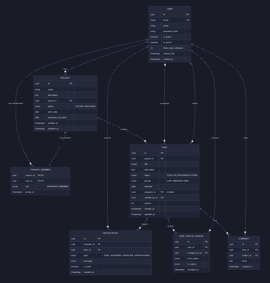
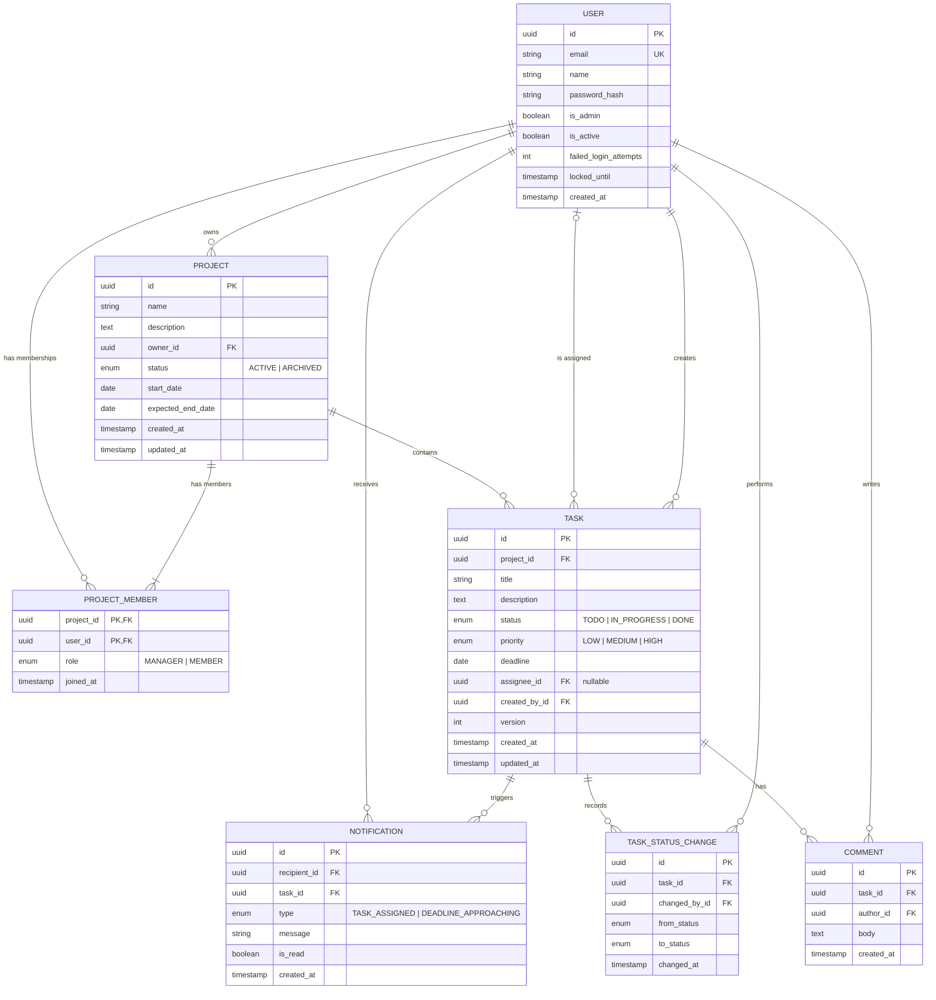

# Matriz — Data Model

> Part of the Matriz **Architecture Pack**. Derived from `requirements.md`,
> `user-stories.md`, and `constraints.md`; architectural context in
> `architecture.md` (ADR-03: single relational database). The database engine is
> still **pending**, so types below are logical (not engine-specific).

## 1. Entities (summary)

| Entity | Purpose | Source |
|--------|---------|--------|
| **User** | A person who signs in; may be a platform Administrator. | FR1, user types |
| **Project** | A body of work with members and tasks. | FR2 |
| **ProjectMember** | Membership of a user in a project, with the per-project role (Project Manager or Member). | FR2, assumption "one role per project" |
| **Task** | Unit of work inside a project, with status, priority, deadline, and assignee. | FR3–FR6, FR9 |
| **Comment** | Text added by a user to a task. | FR8 |
| **TaskStatusChange** | History record of a task status change. | FR10 |
| **Notification** | In-app alert for a user. | FR11 |

## 2. Attributes and identifiers

Conventions: every entity has a surrogate primary key `id` (UUID). `PK` = primary
key, `FK` = foreign key, `UK` = unique. Timestamps are stored in UTC.

### User
| Attribute | Type | Rules |
|-----------|------|-------|
| id | UUID | PK |
| email | string | UK, required, case-insensitive |
| name | string | required |
| password_hash | string | required; hash only, never plain text |
| is_admin | boolean | default `false` (platform Administrator — ADR-04) |
| is_active | boolean | default `true`; deactivate instead of deleting |
| failed_login_attempts | integer | default 0; brute-force protection |
| locked_until | timestamp | nullable; temporary lockout |
| created_at | timestamp | required |

### Project
| Attribute | Type | Rules |
|-----------|------|-------|
| id | UUID | PK |
| name | string | required |
| description | text | optional |
| owner_id | UUID | FK → User; required; must be a Project Manager of the project |
| status | enum `ACTIVE`, `ARCHIVED` | default `ACTIVE`; archive = soft delete (ADR-07) |
| start_date | date | optional |
| expected_end_date | date | optional; if both dates set, `expected_end_date ≥ start_date` |
| created_at / updated_at | timestamp | required |

### ProjectMember
| Attribute | Type | Rules |
|-----------|------|-------|
| project_id | UUID | PK (part), FK → Project |
| user_id | UUID | PK (part), FK → User |
| role | enum `MANAGER`, `MEMBER` | required; one role per user per project |
| joined_at | timestamp | required |

### Task
| Attribute | Type | Rules |
|-----------|------|-------|
| id | UUID | PK |
| project_id | UUID | FK → Project; required |
| title | string | required, non-empty (US3) |
| description | text | optional |
| status | enum `TODO`, `IN_PROGRESS`, `DONE` | required; initial value `TODO` (US3) |
| priority | enum `LOW`, `MEDIUM`, `HIGH` | required; default `MEDIUM` when not provided (see P8) |
| deadline | date | optional (see P8) |
| assignee_id | UUID | FK → User; the task "owner" in the requirements; required on creation, becomes `NULL` when the assignee is removed from the project (exceptional case 2) |
| created_by_id | UUID | FK → User; required |
| version | integer | required; starts at 1, `≥ 1`; optimistic concurrency (ADR-05); incremented on every update |
| created_at / updated_at | timestamp | required |

Derived (not stored, ADR-06):
- `is_overdue` = `deadline < today` **and** `status ≠ DONE` (FR9).
- `needs_reassignment` = `assignee_id IS NULL` (exceptional case 2).

### Comment
| Attribute | Type | Rules |
|-----------|------|-------|
| id | UUID | PK |
| task_id | UUID | FK → Task; required |
| author_id | UUID | FK → User; required |
| body | text | required, non-empty |
| created_at | timestamp | required |

### TaskStatusChange
| Attribute | Type | Rules |
|-----------|------|-------|
| id | UUID | PK |
| task_id | UUID | FK → Task; required |
| changed_by_id | UUID | FK → User; required (author) |
| from_status | enum task status | required (previous status) |
| to_status | enum task status | required; `to_status ≠ from_status` |
| changed_at | timestamp | required (date) |

Append-only: rows are never updated or deleted. Written in the same transaction
as the task status update (ADR-08).

### Notification
| Attribute | Type | Rules |
|-----------|------|-------|
| id | UUID | PK |
| recipient_id | UUID | FK → User; required |
| task_id | UUID | FK → Task; required in the MVP (both notification types refer to a task) |
| type | enum `TASK_ASSIGNED`, `DEADLINE_APPROACHING` | required |
| message | string | required; must not contain sensitive data |
| is_read | boolean | default `false` |
| created_at | timestamp | required |

Uniqueness: at most one `DEADLINE_APPROACHING` notification per
(`recipient_id`, `task_id`, deadline value), so the periodic job is idempotent
and does not create duplicates on every run.

## 3. Relationships and cardinalities

| Relationship | Cardinality | Notes |
|--------------|-------------|-------|
| User — ProjectMember — Project | User 1 : 0..N ProjectMember; Project 1 : 1..N ProjectMember | Many-to-many User↔Project resolved by ProjectMember; a project has at least one member (its owner, as Manager). |
| User **owns** Project | User 1 : 0..N Project; Project N : 1 User | `owner_id`. |
| Project **contains** Task | Project 1 : 0..N Task; Task N : 1 Project | A task belongs to exactly one project. |
| User **is assigned** Task | User 1 : 0..N Task; Task N : 0..1 User | `assignee_id` nullable only after member removal. |
| User **creates** Task | User 1 : 0..N Task | `created_by_id`. |
| Task **has** Comment | Task 1 : 0..N Comment | |
| User **writes** Comment | User 1 : 0..N Comment | |
| Task **has** TaskStatusChange | Task 1 : 0..N TaskStatusChange | |
| User **performs** TaskStatusChange | User 1 : 0..N TaskStatusChange | |
| User **receives** Notification | User 1 : 0..N Notification | |
| Task **triggers** Notification | Task 1 : 0..N Notification | |

## 4. ER diagram (Mermaid)

## 5. Business rules

Confirmed (from the Specification Pack):
- BR1 — A new task starts in `TODO` and requires a non-empty title and an
  assignee (US3).
- BR2 — Status values are `TODO`, `IN_PROGRESS`, `DONE` (FR4).
- BR3 — Only the task assignee or a Project Manager of the project can change a
  task's status, priority, or deadline (FR4, FR5, US4).
- BR4 — Every status change creates a `TaskStatusChange` with previous status,
  new status, author, and date (FR10, US4).
- BR5 — A task is overdue when its deadline has passed and it is not `DONE`
  (FR9).
- BR6 — Project progress = tasks `DONE` / total tasks; a project with no tasks
  shows 0% / "no tasks" (FR7, exceptional case 4).
- BR7 — Removing a member unassigns their tasks in that project; tasks are not
  deleted (exceptional case 2).
- BR8 — A stale task update (version mismatch) is rejected (exceptional case 3).
- BR9 — Setting a deadline before today requires explicit confirmation
  (exceptional case 1).
- BR10 — Users only see projects and tasks they are entitled to (NFR Privacy);
  for Members and Project Managers this means projects they belong to.

Design decisions made in this model (proposed):
- D1 — The task "owner" of the requirements is modelled as `assignee_id` to
  avoid confusion with the project `owner_id`.
- D2 — Administrator is a platform flag (`User.is_admin`); per-project roles
  live in `ProjectMember.role` (ADR-04).
- D3 — Project `status` is limited to `ACTIVE` / `ARCHIVED`; archived projects
  are read-only and hidden from default lists.
- D4 — `is_overdue`, `needs_reassignment`, and project progress are derived, not
  stored (ADR-06).
- D5 — The project owner must be a `MANAGER` member of that project.
- D6 — Only Project Managers (and Administrators) create tasks and choose the
  assignee; the assignee must be a member of the project.
- D7 — Users and projects are deactivated/archived instead of deleted, so
  history, comments and notifications keep valid references. This follows the
  `constraints.md` guideline "prefer soft delete", but narrows the
  Administrator permission "deleting projects" in `requirements.md` — see P10.
- D8 — Sessions and rate-limiting counters beyond the `User` fields are
  implementation details of the Identity & Access module and are not part of
  this logical model (session lifecycle in `architecture.md`, ADR-09).
- D9 — Membership invariants (D5, D6) are enforced by the owning modules inside
  the same transaction as the change; a composite foreign key
  (`project_id`, `assignee_id`) → `ProjectMember` may additionally be used at
  implementation time. They are not drawn in the ER diagram to keep it readable.
- D10 — The project owner cannot be removed from the project or demoted to
  `MEMBER` until ownership is transferred to another Manager, so every project
  always keeps at least one Manager.
- D11 — The `TASK_ASSIGNED` notification is created in the same transaction as
  the assignment, so it cannot be lost.
- D12 — `DEADLINE_APPROACHING` notifications go to the assignee only;
  unassigned tasks get no reminder (they are already flagged on the dashboard
  as needing reassignment) — see P9.
- D13 — Administrators can see all projects and tasks. Inferred from the
  Administrator permission "Everything" in `requirements.md`; to be confirmed.

Assumptions / to confirm:
- P1 — Are there project statuses beyond Active/Archived (e.g. "Completed",
  "On hold")? FR2 lists "status" without values.
- P2 — Can a task be moved back from `DONE` to another status (reopen)? Assumed
  **yes**, any transition between the three statuses is allowed and recorded.
- P3 — Can Members edit the title/description of tasks assigned to them? FR3
  says Members "manage (edit/update)" their tasks; assumed **yes**, but they
  cannot reassign them.
- P4 — Can comments be edited or deleted? Assumed **no** in the MVP.
- P5 — Is the deadline a date or a date-time? Assumed a calendar date.
- P6 — Who can comment: assumed any member of the task's project.
- P7 — Retention of read notifications (assumed kept indefinitely in the MVP).
- P8 — Are priority and deadline mandatory at task creation? FR3/FR5 say a task
  "has" them, but US3 only requires title and owner. Assumed: priority defaults
  to `MEDIUM` and deadline is optional.
- P9 — Should Project Managers be notified about unassigned tasks approaching
  their deadline? Assumed **no** in the MVP (D12).
- P10 — Is a permanent (hard) delete of projects by Administrators needed in the
  MVP? `requirements.md` lists "deleting projects" for Administrators; assumed
  **archive only** (D7, ADR-07) until the client confirms.
- P11 — What happens to tasks assigned to a user who is deactivated
  (`is_active = false`)? Exceptional case 2 only covers removal from a project.
  Assumed: the same rule applies (tasks become unassigned and flagged for
  reassignment), pending confirmation.
