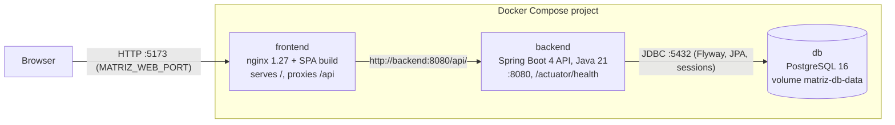
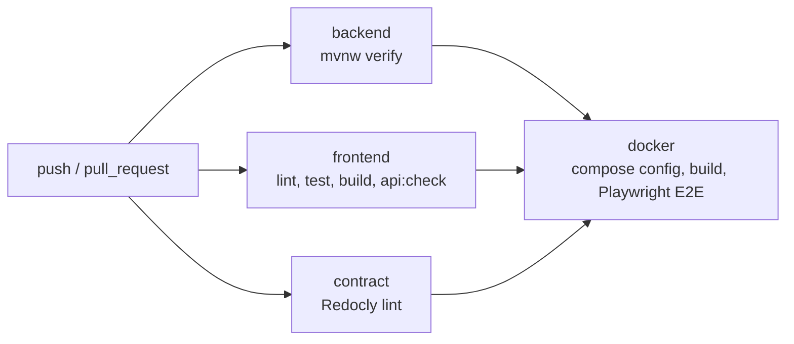

# Matriz — Delivery Plan (release 1)

Technical plan for preparing release 1 for delivery: container images,
integrated execution with Docker Compose, continuous integration with GitHub
Actions, documentation and a release candidate. It starts from an analysis of
the current state of the repository (§2) and defines the strategy (§3), the
decisions (§4), the stages with the files to create or change (§5) and the
open decisions (§6). The commands actually run during the analysis are listed
in §7; §8 is reserved for the final validation report.

Sources: [`AGENTS.md`](../AGENTS.md), [`README.md`](../README.md),
[`architecture.md`](architecture.md), [`implementation-plan.md`](implementation-plan.md),
[`constraints.md`](constraints.md), [`test-plan.md`](test-plan.md),
[`quality-security-review.md`](quality-security-review.md) and the files cited
in each section.

Ground rules for every stage: respect the existing stack (Spring Boot 4 /
Java 21 / Maven wrapper, React + Vite + TypeScript, PostgreSQL 16, Flyway,
nginx) and add no component the application does not need; no credentials in
any tracked file, Dockerfile or workflow (`.env.example` holds fictitious
values only); behaviour verified in release 1 must not change; every stage
records its evidence here and adds a "Delivery" row to the change log of
[`implementation-plan.md`](implementation-plan.md) §8.

## 1. Status overview

| # | Stage | Status |
|---|-------|--------|
| 1 | Analysis and delivery plan (this document) | Done |
| 2 | Container images (Dockerfiles, `.dockerignore`) | Done (§5, Stage 2 as built) |
| 3 | Docker Compose (`compose.yaml`, `.env.example`, healthchecks, volumes, networks) | Done (§5, Stage 3 as built) |
| 4 | Continuous integration (`.github/workflows/ci.yml`) | Done (§5, Stage 4 as built) |
| 5 | Documentation and release candidate (README, architecture, CHANGELOG, release notes) | Done (§5, Stage 5 as built; version 1.0.0) |
| 6 | Final validation and troubleshooting (§8) | Planned |

## 2. Analysis of the current state

### 2.1 Components

| Component | Technology (as built) | Source | Runtime role |
|-----------|----------------------|--------|--------------|
| SPA (`frontend/`) | React 19, React Router 8, TanStack Query 5, `openapi-fetch` client generated from `openapi.yaml`, Vite 8, TypeScript 5.9 | `frontend/package.json` | Built to static files; served by nginx in the container, by the Vite dev server (proxy `/api`) in development |
| Web server / reverse proxy | nginx 1.27 (alpine) | `frontend/Dockerfile`, `frontend/nginx.conf` | Serves the SPA (history fallback) and proxies `/api/` to `backend:8080`, replacing `X-Forwarded-For` (finding F-02) |
| API (`backend/`) | Spring Boot 4.1.2 (Web MVC, Security, Session JDBC, Data JPA, Validation, Actuator, Flyway), Spring Modulith 2.1.1, Bouncy Castle (Argon2id), Java 21, virtual threads | `backend/pom.xml` | Modular monolith (`identity`, `projects`, `tasks`, `comments`, `dashboard`, `demo`, `shared`); applies migrations and the optional demo seed on start; `GET /actuator/health` public |
| Database | PostgreSQL 16 (`postgres:16-alpine`), Flyway `V1__schema.sql`, `V2__spring_session.sql` | `docker-compose.yml`, `backend/src/main/resources/db/migration/` | Application data and HTTP sessions; named volume `matriz-db-data` |
| API contract | OpenAPI 3.1, `info.version` 0.2.3, Redocly lint (`redocly.yaml`) | `openapi.yaml` | Source of truth for the API (ADR-0016); backend tests validate responses against it; frontend types generated from it |
| E2E stack | Playwright 1.65 (Chromium) against the Compose images, isolated project `matriz-e2e` | `frontend/playwright.config.ts`, `frontend/e2e/` | Test only |
| Static analysis | oxlint; Semgrep 1.184.0 in Docker with project rules | `frontend/.oxlintrc.json`, `.semgrep.yml`, `scripts/semgrep.sh` | Check only |

There is no cache, message broker, e-mail server, object storage or external
API: PostgreSQL is the only runtime service.

### 2.2 Dependencies, versions and commands

| Item | Version in the repository | Notes |
|------|---------------------------|-------|
| Application versions | backend `0.1.0-SNAPSHOT` (`pom.xml`), frontend `0.1.0` (`package.json`), API contract `0.2.3` (`openapi.yaml`) | No tag, no `CHANGELOG.md`, no release yet (state before Stage 5; now `1.0.0`, see Stage 5 as built) |
| Java | 21 (`java.version`); images `eclipse-temurin:21-jdk` (build) and `eclipse-temurin:21-jre` (runtime) | Local: Java 21.0.4; built runtime image: OpenJDK 21.0.13 on Ubuntu 26.04 |
| Maven | wrapper 3.3.4, `distributionType=only-script`, Maven 3.10.0 from `repo.maven.apache.org` | No wrapper JAR in the repository; Maven Central is the default repository |
| Node.js / npm | Image `node:22-alpine`; README requires 20.19+ / 22.12+ | Local: Node 25.2.1, npm 11.6.2; no `engines` field; `package-lock.json` (lockfile) present |
| Web server | `nginx:1.27-alpine` (built image: nginx 1.27.5) | |
| Database | `postgres:16-alpine` (Compose and Testcontainers) | |
| Docker / Compose | Local: Docker 28.5.1, Compose v2.40.2 | Compose uses `!reset`/`!override` (needs Compose ≥ 2.24) |
| Semgrep | `semgrep/semgrep:1.184.0` | Registry rulesets downloaded at run time |
| Redocly CLI | not pinned (`npx --yes @redocly/cli lint`) | Version resolved at run time (reproducibility gap, §2.5 G9) |

Commands to build, run and check (all documented in `README.md` and
`AGENTS.md`, from the repository root):

| Purpose | Command |
|---------|---------|
| Configuration | `cp .env.example .env` |
| Database only | `docker compose up -d db` |
| API (development) | `cd backend && ./mvnw spring-boot:run` (profile `local`, reads `../.env`) |
| SPA (development) | `cd frontend && npm ci && npm run dev` (port 5173, proxies `/api`) |
| Whole stack in containers | `docker compose up -d --build`, `docker compose ps`, `docker compose logs -f backend`, `docker compose down [-v]` |
| Backend build + tests | `cd backend && ./mvnw verify` (Docker needed: Testcontainers) |
| Frontend tests / lint / build / contract drift | `npm test`, `npm run lint`, `npm run build`, `npm run api:check` (in `frontend/`) |
| Contract lint | `npx --yes @redocly/cli lint openapi.yaml` |
| E2E | `cd frontend && npx playwright install chromium && npm run test:e2e` |
| Semgrep | `scripts/semgrep.sh` (`--error` to fail on findings) |

### 2.3 External services and environment variables

Services used at build or test time (network access needed): Maven Central
(Maven distribution and dependencies), npm registry (packages, `npx`
tools), Docker Hub (`postgres`, `eclipse-temurin`, `node`, `nginx`,
`semgrep/semgrep` images), the Playwright browser download, and the Semgrep
registry (rulesets). Behind a TLS-inspecting proxy, `MATRIZ_EXTRA_CA_CERT`
supplies an extra CA certificate.

Every environment variable found in the application configuration
(`application.yml`, `application-local.yml`), `.env.example`,
`docker-compose.yml`, the Dockerfiles, the E2E files and the scripts:

| Variable | Read by | Default | In `.env.example` | Purpose |
|----------|---------|---------|-------------------|---------|
| `MATRIZ_DB_HOST` | backend | `localhost` | yes | Database host (Compose sets `db`) |
| `MATRIZ_DB_PORT` | backend; Compose (host port of `db`) | `5432` | yes | Database port (Compose forces `5432` inside the network) |
| `MATRIZ_DB_NAME` | backend (default `matriz`); Compose (`POSTGRES_DB`, required) | — in Compose | yes | Database name |
| `MATRIZ_DB_USER` | backend; Compose (`POSTGRES_USER`, required) | none | yes | Database user |
| `MATRIZ_DB_PASSWORD` | backend; Compose (`POSTGRES_PASSWORD`, required) | none | yes (fictitious) | Database password |
| `MATRIZ_API_PORT` | backend (`server.port`); Compose (host port of `backend`); Vite proxy | `8080` | yes | API port (Compose forces `8080` inside the container) |
| `MATRIZ_SEED_DEMO` | backend (`matriz.demo.seed`) | `false` | yes | Seed demo data when `users` is empty |
| `MATRIZ_DEMO_PASSWORD` | backend (`matriz.demo.password`); E2E | empty | yes (fictitious) | Password of every demo account |
| `MATRIZ_WEB_PORT` | Compose (host port of `frontend`) | `5173` | commented | SPA port in Compose |
| `MATRIZ_EXTRA_CA_CERT` | Compose (build secret `extra_ca`, frontend image only); `scripts/semgrep.sh` | `/dev/null` | commented | Extra CA for builds behind a TLS-inspecting proxy |
| `SPRING_PROFILES_ACTIVE` | backend | none | no (Compose sets `local`) | Profile (`local`: plain HTTP, cookies without `Secure`) |
| `SERVER_FORWARD_HEADERS_STRATEGY` | backend | none | no (Compose sets `native`) | Trust `X-Forwarded-For` from nginx |
| `MANAGEMENT_HEALTH_READINESSSTATE_ENABLED` | backend | `false` | no (E2E overlay sets `true`) | Readiness state in `/actuator/health` (healthy only after the seed) |
| `POSTGRES_DB`, `POSTGRES_USER`, `POSTGRES_PASSWORD` | `db` image | — | no (mapped from `MATRIZ_DB_*`) | Database initialisation |
| `VITE_API_BASE_URL` | frontend build (`src/api/client.ts`) | `/api/v1` | no | API base URL baked in at build time |
| `MATRIZ_E2E_WEB_PORT` | Playwright config, E2E overlay | `5180` | no | SPA port of the E2E stack |
| `E2E_KEEP_STACK` | E2E teardown | unset | no | Keep the E2E stack after a run |
| `CI` | Playwright config (`forbidOnly`) | unset | no | Set by CI runners |
| `SEMGREP_IMAGE` | `scripts/semgrep.sh` | `semgrep/semgrep:1.184.0` | no | Override of the Semgrep image |

No variable holds a real secret: the only credentials are the fictitious
database and demo passwords of `.env.example` (documented in the README).
`.env` is git-ignored (`.gitignore`) and excluded from the backend build
context (`backend/.dockerignore`).

### 2.4 Automated tests and checks

| Suite | Tooling | Where | Inventory |
|-------|---------|-------|-----------|
| Backend unit, integration, API/contract, security, migration, modularity, smoke | JUnit 5, Spring Boot Test, MockMvc + `openapi-request-validator`, Testcontainers PostgreSQL 16, Spring Modulith | `backend/src/test/java/` | 18 test classes plus `ApiIntegrationTest` and `TestcontainersConfiguration`; 132 `@Test`/`@ParameterizedTest` methods (179 test cases in the last recorded run, [`test-plan.md`](test-plan.md) §9.3) |
| Frontend unit / component | Vitest 4 + React Testing Library, in-memory fake API | `frontend/src/**/*.test.ts(x)` | 5 files, 61 tests (run in this analysis: 61 passed) |
| End-to-end | Playwright 1.65, Chromium, Compose stack `matriz-e2e` | `frontend/e2e/create-task.e2e.ts` | 1 test (sign in → create task → check list) |
| Lint | oxlint | `frontend/.oxlintrc.json` | `npm run lint` |
| Type check + production build | `tsc -b && vite build` | `frontend/` | `npm run build` |
| Contract drift | `openapi-typescript` + `git diff --exit-code` | `frontend/src/api/schema.d.ts` | `npm run api:check` |
| Contract lint | Redocly CLI | `openapi.yaml`, `redocly.yaml` | `npx --yes @redocly/cli lint openapi.yaml` |
| Static analysis | Semgrep (project rules + registry rulesets) | `.semgrep.yml`, `scripts/semgrep.sh` | Findings require manual triage ([`quality-security-review.md`](quality-security-review.md) §6) |

### 2.5 Gaps against the delivery requirements

| ID | Gap | Evidence | Addressed in |
|----|-----|----------|--------------|
| G1 | The Compose file is `docker-compose.yml`; the delivery asks for `compose.yaml` | `git ls-files` | Stage 3 (D-01) |
| G2 | Healthcheck only on `db`; `backend` and `frontend` have none, so `frontend` starts before the API is ready and `docker compose up --wait` cannot confirm the whole stack | `docker-compose.yml` | Stage 3 (D-03) |
| G3 | No explicit network: every service shares the default network, so `frontend` can reach `db` | `docker compose config` (only `matriz_default`) | Stage 3 (D-02) |
| G4 | No CI workflow (`.github/` does not exist) | `ls .github` | Stage 4 |
| G5 | Floating base-image tags (`eclipse-temurin:21-jdk`/`21-jre`, `node:22-alpine`, `nginx:1.27-alpine`, `postgres:16-alpine`): a rebuild can pick another patch or OS release | Dockerfiles, Compose | Stage 2 (D-07) |
| G6 | `MATRIZ_EXTRA_CA_CERT` is used only by the frontend image build; the backend build (`mvnw dependency:go-offline`) has no extra-CA support, although the README says the variable applies to "the image builds" | `backend/Dockerfile`, README | Stage 2 (check; fix only if a build behind the proxy fails) |
| G7 | `frontend/.dockerignore` does not exclude `.env*` or `*.local`; `backend/.dockerignore` covers `target/`, `.env`, `*.log` only (no `.idea/`, `*.iml`). `frontend/e2e/` must stay in the context: `tsconfig.node.json` includes it and `tsc -b` would fail without it | `.dockerignore` files, `frontend/tsconfig.node.json` | Stage 2 |
| G8 | No `CHANGELOG.md`, no release notes, no SemVer release version | `git ls-files` | Stage 5 (D-06) |
| G9 | Redocly CLI version not pinned (`npx --yes @redocly/cli`) | README, `AGENTS.md` | Stage 4 (pin in CI and in the documented command) |
| G10 | The README describes the architecture without the container view; `architecture.md` has a component diagram but no deployment/runtime (Compose) diagram | `docs/architecture.md` §4 | Stage 5 |
| G11 | `backend` publishes the API on the host (useful for `curl`) and `db` on `127.0.0.1:5432` (needed by `./mvnw spring-boot:run`); both stay, bound to `127.0.0.1` only | `docker-compose.yml` | Kept (documented) |
| G12 | The nginx container runs as root (default image); the API image already runs as a non-root user | `frontend/Dockerfile`, `backend/Dockerfile` | Recorded as a limitation (S-01 security headers also deferred) |

## 3. Strategy for a reproducible environment

1. **Containers are the reference runtime.** The only host requirements for
   running Matriz are Docker with Compose and a `.env` copied from
   `.env.example`. Java and Node.js stay needed only for development and for
   the tests outside CI.
2. **Multi-stage images built from lockfiles.** The backend image resolves
   dependencies from `pom.xml` through the Maven wrapper (Maven version fixed
   in `maven-wrapper.properties`) against Maven Central; the frontend image
   installs with `npm ci` from `package-lock.json`. Base images are pinned to
   exact patch tags (D-07); tests are not run inside image builds (they run
   in CI before the image build).
3. **One Compose file for development and the full stack**, with healthchecks
   on every service, explicit networks, a named volume for PostgreSQL and
   start order based on health (`depends_on: condition: service_healthy`), so
   `docker compose up -d --wait` returns only when the application is usable.
4. **Isolated, throw-away stacks for tests**: Testcontainers for the backend
   tests and the `matriz-e2e` Compose project (tmpfs database, fictitious
   values from `.env.example`) for E2E; neither touches the development volume.
5. **CI on clean GitHub-hosted runners** (`ubuntu-latest`, Docker available)
   with pinned tool versions (Temurin 21, Node 22, Maven from the wrapper,
   Maven Central only, no `settings.xml` mirror), dependency caches keyed on
   `pom.xml` and `package-lock.json`, read-only permissions and no secrets.

## 4. Decisions

| ID | Decision | Justification |
|----|----------|---------------|
| D-01 | **Rename `docker-compose.yml` to `compose.yaml` with `git mv`**, and the E2E overlay `frontend/e2e/docker-compose.e2e.yml` to `frontend/e2e/compose.e2e.yaml`; update every living reference in the same commit: `frontend/e2e/stack.ts` (`--file` paths), the overlay's header comment, `backend/Dockerfile` and `frontend/Dockerfile` comments, `.semgrep.yml` (rule message), `README.md` (repository layout, Compose section, E2E section), `AGENTS.md` if it names the file, `docs/architecture.md`, `docs/test-plan.md` §11 (application under test) and the reproduction command in `docs/quality-security-review.md`. Historical change-log rows stay as written. | `compose.yaml` is the canonical name of the Compose specification and the first file Compose looks for, so every documented `docker compose …` command keeps working unchanged. Keeping both files is rejected: Compose picks one and warns, and two copies drift. A symlink is rejected: fragile on Windows checkouts and confusing in reviews. `git mv` keeps the file history. |
| D-02 | Two explicit networks: `backend-net` (`db`, `backend`) and `frontend-net` (`backend`, `frontend`). No fixed `name:` so the `matriz-e2e` project keeps its own networks. | Only the API talks to the database; nginx only reaches the API (least privilege). Service names remain the DNS names already used (`db`, `backend`). |
| D-03 | Healthchecks: `db` keeps `pg_isready`; `backend` uses `curl -fsS http://localhost:8080/actuator/health` (endpoint public, `curl` present in the runtime image); `frontend` uses `curl -fsS http://localhost/` (`curl` present in the nginx image); `frontend` depends on `backend` being healthy. The E2E overlay keeps its faster intervals and the readiness state (`MANAGEMENT_HEALTH_READINESSSTATE_ENABLED`). | Uses the existing Actuator endpoint (no new dependency); avoids nginx `502` while the API starts; enables `docker compose up --wait`. |
| D-04 | **The Playwright E2E test runs in CI**, in the image job after the test jobs: the job builds the images with Compose and then runs `npm run test:e2e`, which reuses the build cache. | It is the only test of the containerised application end to end (nginx proxy, API, database, seed), so it is the strongest evidence that the images work; it needs only Docker and the fictitious values of `.env.example` (no secrets); recorded local runs took 1.7 min including the image build and 15–16 s with cached images ([`test-plan.md`](test-plan.md) §11). Trace and screenshot are uploaded as an artifact only on failure. |
| D-05 | Semgrep is **not** a CI step; it stays a documented local check with manual triage. | Its results need human triage (false positives are recorded in the review), the registry rulesets change over time (non-reproducible gate), and security-scanning pipelines are beyond the required scope. |
| D-06 | *Superseded in Stage 5 by the owner's decision on O-01: version **`1.0.0`**, no pre-release suffix; the rest (contract keeps `0.2.3`, tag created by the owner) stands.* Release candidate version **`0.1.0-rc.1`** (SemVer pre-release); `pom.xml` goes from `0.1.0-SNAPSHOT` to `0.1.0-rc.1` and `package.json`/`package-lock.json` from `0.1.0` to `0.1.0-rc.1` (`npm version 0.1.0-rc.1 --no-git-tag-version`). The API contract keeps its own version (`0.2.3`). Proposed tag: `v0.1.0-rc.1`, created by the repository owner (not by the agent). | Both components already declare 0.1.0 and nothing has been released, so the first release is 0.1.0; it stays below 1.0.0 because there is no production hosting, no account management and the deferred features are pending (`constraints.md`). The contract version tracks API changes independently (ADR-0016). |
| D-07 | Pin base images to exact patch tags verified in Stage 2 (for example `postgres:16.<x>-alpine`, `nginx:1.27.<x>-alpine`, `node:22.<x>-alpine`, `eclipse-temurin:21.0.<x>_<b>-jdk/-jre`), in the Dockerfiles, `compose.yaml` and `TestcontainersConfiguration`. Digests are not used. | Rebuilds stay on the same runtime versions while tags remain readable; digests would block security patches until edited by hand. |
| D-08 | API documentation stays contract-first: `openapi.yaml` is the documentation; the README gains an "API documentation" section with the operation overview (`implementation-plan.md` §5) and the command to render it locally (`npx --yes @redocly/cli@<pinned> build-docs openapi.yaml -o <output outside the repository>`). No Swagger UI/springdoc in the backend. | Avoids a new runtime dependency and an unauthenticated documentation endpoint; the contract is already linted and enforced by tests. |
| D-09 | CI uses only GitHub-owned actions (`actions/checkout`, `actions/setup-java`, `actions/setup-node`, `actions/upload-artifact`) pinned to a major version, `permissions: contents: read`, `concurrency` to cancel superseded runs on the same ref, and `timeout-minutes` per job. | Minimal permissions and a small supply-chain surface; no third-party action is needed. |

## 5. Stages, files and steps

### Stage 2 — Container images

Files: `backend/Dockerfile`, `frontend/Dockerfile`, `backend/.dockerignore`,
`frontend/.dockerignore` (change); no new image is needed (PostgreSQL uses the
official image).

1. Pin the base images (D-07), checking each tag exists.
2. Complete `.dockerignore` (G7): frontend adds `.env*`, `*.local`, editor
   folders; backend adds `.idea/`, `*.iml`. Keep `frontend/e2e/` in the context.
3. Keep: multi-stage builds, `npm ci` from the lockfile, Maven wrapper with
   Maven Central, non-root API user, `EXPOSE 8080`/`80`, entry points.
   Check G6 (backend build behind the TLS-inspecting proxy); add extra-CA
   support to the backend build only if that build fails, otherwise correct
   the README sentence.
4. Build and run each image on its own: `docker build -t matriz-backend:dev backend`,
   `docker build -t matriz-frontend:dev frontend`, `docker images`,
   `docker run` of the API against a PostgreSQL container on a user network,
   `docker ps`, `docker logs`, `curl /actuator/health`.
5. Confirm no credential in the Dockerfiles (`git grep` and Semgrep
   `p/dockerfile`, `p/secrets`).

Done when both images build from a clean cache, the API reports `UP` with
`db` `UP`, nginx serves the SPA, and no credential appears in the images'
build files.

#### Stage 2 — As built (2026-11-18)

| Item | Change |
|------|--------|
| Base images (D-07, G5) | `backend/Dockerfile`: `eclipse-temurin:21.0.13_9-jdk` (build) and `eclipse-temurin:21.0.13_9-jre` (runtime); `frontend/Dockerfile`: `node:22.23.5-alpine` (build) and `nginx:1.27.5-alpine` (runtime). The same patch level the floating tags resolved to; tags checked on Docker Hub. `postgres:16-alpine` → `postgres:16.16-alpine` in `docker-compose.yml` (image line only; rename, networks and healthchecks stay for Stage 3) and in `TestcontainersConfiguration`, so tests and runtime use the same database version. |
| `.dockerignore` (G7) | `backend/.dockerignore` adds `.env.*`, `.idea/`, `.vscode/`, `*.iml`, `.DS_Store`; `frontend/.dockerignore` adds `.env`, `.env.*`, `*.local`, `.idea/`, `.vscode/`, `*.iml`, `.DS_Store`. `frontend/e2e/` is kept (comment in the file): `tsconfig.node.json` includes it and the image build runs `tsc -b`. |
| Kept unchanged | Multi-stage builds; `npm ci` from `package-lock.json`; Maven wrapper resolving from Maven Central; tests not run in the image build; API as non-root user `matriz` (uid 999), `EXPOSE 8080`, `ENTRYPOINT ["java", "-jar", "app.jar"]`; nginx `EXPOSE 80`, default `nginx -g 'daemon off;'`, `nginx.conf` proxying `/api/` to `backend:8080`. |
| G6 (extra CA) | The backend image builds from a clean cache **without** the extra CA on this network (behind the TLS-inspecting proxy), so no extra-CA support was added to it. The frontend build **fails** without it (`npm ci`: "Exit handler never called!" after 70 s) and succeeds with `--secret id=extra_ca,src=<pem>`. The README, `.env.example`, the Compose comment, `scripts/semgrep.sh` and `quality-security-review.md` now say the certificate is used by the frontend image build (and Semgrep), not by "the image builds". |
| Health endpoint for Stage 3 | `GET /actuator/health` exists and is public (`SecurityConfig`: `permitAll`); `curl` 8.18.0 is present in the API runtime image. No change needed. |
| README | "Run with Docker Compose": corrected extra-CA paragraph, pinned base images, `docker build` of each image on its own. |

Evidence (all run on 2026-11-18 from the repository root, Docker 28.5.1;
values from `.env` were loaded into the shell with `set -a; . ./.env` and
passed as `-e NAME` without printing them):

| Command | Result |
|---------|--------|
| `docker build --no-cache --pull -t matriz-backend:dev backend` | Success in 24 s (`dependency:go-offline` 18.8 s, `package` 3.8 s), no extra CA |
| `docker build --no-cache --pull -t matriz-frontend:dev frontend` | **Failed** at `npm ci` (no extra CA behind the TLS-inspecting proxy; expected, see G6) |
| `docker build --no-cache -t matriz-frontend:dev --secret id=extra_ca,src=<pem> frontend` | Success in 12 s (`npm ci` 8.1 s, `npm run build` 2.3 s) |
| `docker images --filter reference='matriz-*:dev'` | `matriz-backend:dev` `2fd00758baf5` 414 MB; `matriz-frontend:dev` `459db88d10b1` 50.1 MB |
| `docker build --target build …` + `ls -a /app` (context check, temporary tags removed) | Backend context: `.mvn`, `mvnw`, `pom.xml`, `src` (no `target/`, `.env`); frontend: sources, `e2e/` present, no `.env*`, `node_modules/` or `dist/` from the host |
| `docker history --no-trunc` (both images) piped to `grep -iE 'password\|secret\|token'`; `git grep -inE 'password\|secret\|token\|ARG \|ENV '` on the Dockerfiles | No credential; the only match is the `extra_ca` build-secret mount (not stored in the image) |
| `docker inspect` | API: user `matriz`, port `8080/tcp`, entrypoint `java -jar app.jar`, JDK 21.0.13+9; SPA: port `80/tcp`, `nginx -g daemon off;` |
| `docker network create matriz-ex2-net` | Created |
| `docker run -d --name matriz-ex2-db --network matriz-ex2-net --network-alias db -e POSTGRES_DB="$MATRIZ_DB_NAME" -e POSTGRES_USER="$MATRIZ_DB_USER" -e POSTGRES_PASSWORD="$MATRIZ_DB_PASSWORD" postgres:16.16-alpine`; `docker exec matriz-ex2-db pg_isready …` | Accepting connections |
| `docker run -d --name matriz-ex2-backend --network matriz-ex2-net --network-alias backend -p 127.0.0.1:8081:8080 -e SPRING_PROFILES_ACTIVE=local -e MATRIZ_DB_HOST=db -e MATRIZ_DB_PORT=5432 -e MATRIZ_API_PORT=8080 -e MATRIZ_DB_NAME -e MATRIZ_DB_USER -e MATRIZ_DB_PASSWORD -e MATRIZ_SEED_DEMO -e MATRIZ_DEMO_PASSWORD -e SERVER_FORWARD_HEADERS_STRATEGY=native matriz-backend:dev` | Started in 3.4 s; Flyway applied V1, V2 on PostgreSQL 16.16; demo data seeded (5 users, 3 projects, 9 tasks, 4 comments) |
| `docker run -d --name matriz-ex2-frontend --network matriz-ex2-net -p 127.0.0.1:5174:80 matriz-frontend:dev` | Started |
| `docker ps --filter name=matriz-ex2` | 3 containers `Up`: db `5432/tcp` (not published), backend `127.0.0.1:8081->8080`, frontend `127.0.0.1:5174->80` |
| `curl http://127.0.0.1:8081/actuator/health` | `"status":"UP"`, components `db` `UP`, liveness/readiness `UP` |
| API on `:8081` and through nginx on `:5174`: `GET /api/v1/auth/csrf`; `GET /api/v1/auth/me` (anonymous); `POST /api/v1/auth/sign-in` wrong password; sign-in `ana@matriz.test` with the demo password; `GET /api/v1/auth/me`; `GET /api/v1/projects` | Both origins: `204`, `401`, `401`, `200`, Ana Costa returned, `200` |
| `curl http://127.0.0.1:5174/`, `/projects`, first `/assets/*.js` | `200 text/html` (`<title>Matriz</title>`), `200` (history fallback), `200` |
| `docker logs` (all three) | Backend: 0 lines with `ERROR`/`WARN`/`Exception`; nginx: 0 `[error]`/`[warn]`, `/api/` requests 200/204/401 only; db: no `ERROR`/`FATAL` |
| `docker rm -f matriz-ex2-frontend matriz-ex2-backend matriz-ex2-db`; `docker network rm matriz-ex2-net` | Removed (images `matriz-*:dev` kept) |
| `docker compose config -q`; same with `-p matriz-e2e -f docker-compose.yml -f frontend/e2e/docker-compose.e2e.yml` | Valid |
| `cd backend && ./mvnw -B -ntp verify` | BUILD SUCCESS, 179 tests, 0 failures, 0 errors (Testcontainers on `postgres:16.16-alpine`) |
| `cd frontend && npm test`; `npm run lint`; `npm run build`; `npm run api:check` | 5 files / 61 tests passed; lint exit 0; build exit 0; api:check exit 0 |
| `MATRIZ_EXTRA_CA_CERT=<pem> scripts/semgrep.sh` | 409 rules, 179 files, 19 findings: the same previously triaged false positives ([`quality-security-review.md`](quality-security-review.md)); none on the Dockerfiles or `.dockerignore` |

Not run in this stage: the Playwright E2E test and `docker compose up`
(Stage 3 re-runs both after the Compose changes); Redocly lint (the
contract did not change).

### Stage 3 — Docker Compose

Files: `docker-compose.yml` → `compose.yaml` (`git mv`, change),
`frontend/e2e/docker-compose.e2e.yml` → `frontend/e2e/compose.e2e.yaml`
(`git mv`, change), `frontend/e2e/stack.ts`, `.env.example` (review: all
Compose variables listed, values fictitious), `.semgrep.yml`, Dockerfile
comments, README Compose section (change).

1. Rename (D-01) and update every living reference; `git grep -n
   'docker-compose'` must only match historical rows and the Semgrep ruleset
   name `p/docker-compose`.
2. Add the networks (D-02), the healthchecks and health-based start order
   (D-03); keep the named volume `matriz-db-data` and the `extra_ca` build
   secret.
3. Validate: `docker compose config -q`, `docker compose build`,
   `docker compose up -d --wait`, `docker compose ps` (all `healthy`),
   `docker compose logs --tail=50`, sign-in and a task created through the
   SPA, then `docker compose down` + `up -d` and confirm the task still
   exists (persistence), and `docker compose down -v` removes it.
4. Re-run the E2E test (`npm run test:e2e`) to prove the overlay still works,
   and Semgrep to check that the `p/docker-compose` rules still scan
   `compose.yaml`.

#### Stage 3 — As built (2026-11-18)

| Item | Change |
|------|--------|
| Rename (D-01, G1) | `git mv docker-compose.yml compose.yaml` and `git mv frontend/e2e/docker-compose.e2e.yml frontend/e2e/compose.e2e.yaml`. Living references updated: `frontend/e2e/stack.ts` (`--file` paths), the overlay header, the comments of both Dockerfiles, the `.semgrep.yml` rule message, README (repository layout, Compose and E2E sections), `implementation-plan.md` §3 (repository layout), `test-plan.md` §11 and the reproduction command in `quality-security-review.md` §4.2. `AGENTS.md` and `architecture.md` do not name the file. `git grep -n docker-compose` now matches only this document's analysis and plan text, the Increment 2 file list and a change-log row in `implementation-plan.md`, the F-02 finding and the scope row in `quality-security-review.md` (historical), the README anchor `#run-with-docker-compose` and the ruleset `p/docker-compose`. |
| Networks (D-02, G3) | `backend-net` (`db`, `backend`) and `frontend-net` (`backend`, `frontend`), no fixed `name:`; the E2E project gets its own `matriz-e2e_backend-net`/`matriz-e2e_frontend-net`. |
| Healthchecks (D-03, G2) | `db`: `pg_isready` (unchanged). `backend`: `curl -fsS -o /dev/null http://localhost:8080/actuator/health` (interval 10 s, timeout 5 s, retries 6, `start_period` 60 s, `start_interval` 2 s). `frontend`: `curl -fsS -o /dev/null http://127.0.0.1/` (interval 10 s, retries 3, `start_period` 10 s, `start_interval` 2 s; `127.0.0.1` because `nginx.conf` listens on IPv4 only). `backend` starts after `db` is healthy and `frontend` after `backend` is healthy. The E2E overlay keeps its faster backend healthcheck and the readiness state; its `frontend` `depends_on` override was removed because the base file now has the same condition. |
| Volume, ports, build secret | Named volume `matriz-db-data` (Compose volume `matriz_matriz-db-data`) unchanged. Ports still published on `127.0.0.1` only (G11). `extra_ca` build secret kept for the frontend (Stage 2: required behind the TLS-inspecting proxy). |
| `.env.example` | Already lists every variable `compose.yaml` interpolates (`MATRIZ_DB_NAME`, `MATRIZ_DB_USER`, `MATRIZ_DB_PASSWORD`, `MATRIZ_DB_PORT`, `MATRIZ_API_PORT`; optional `MATRIZ_WEB_PORT` and `MATRIZ_EXTRA_CA_CERT` commented out with their defaults) plus those the backend reads from it (`MATRIZ_DB_HOST`, `MATRIZ_SEED_DEMO`, `MATRIZ_DEMO_PASSWORD`); only the header and the `MATRIZ_API_PORT` comment were updated. Values stay fictitious. |
| README | Layout rows for `compose.yaml` and the E2E overlay; "Run with Docker Compose": validation commands (`config -q`, `up -d --build --wait`, `ps`, `logs --tail=50`, `down`), table of services, networks, healthchecks and start order, isolation of the database, published ports, persistence; E2E section names both Compose files. |

Evidence (all run on 2026-11-18 from the repository root, Docker 28.5.1,
Compose 2.40.2; local `.env` copied from `.env.example` with
`MATRIZ_API_PORT=8081` because 8080 is busy on this machine, and
`MATRIZ_EXTRA_CA_CERT` set; secrets were never printed):

| Command | Result |
|---------|--------|
| `docker compose config -q`; `docker compose -p matriz-e2e -f compose.yaml -f frontend/e2e/compose.e2e.yaml config -q` | Both valid (exit 0). Resolved config: `db` on `backend-net`, `backend` on both, `frontend` on `frontend-net`; `depends_on` `service_healthy` for `backend` (on `db`) and `frontend` (on `backend`); E2E merge keeps tmpfs, no db/API ports, SPA on 5180, backend interval 2 s |
| `docker compose build` | `matriz-backend` and `matriz-frontend` built in 4.3 s (layers cached from Stage 2; clean-cache builds are recorded in Stage 2). Images `matriz-backend:latest` `bbde5f2eaaa9` 414 MB, `matriz-frontend:latest` `50864071c07e` 50.1 MB |
| `docker compose up -d` | Networks `matriz_backend-net`, `matriz_frontend-net` created; `db` healthy → `backend` started and healthy → `frontend` started; 10.5 s |
| `docker compose ps` (5 s later) | `db` `Up (healthy)` `127.0.0.1:5432->5432`; `backend` `Up (healthy)` `127.0.0.1:8081->8080`; `frontend` `Up (healthy)` `127.0.0.1:5173->80` |
| `docker compose logs --tail=50` | 87 lines, 0 with `error`/`exception`/`fatal`/`warn`. Backend: Flyway validated 2 migrations on PostgreSQL 16.16 (`jdbc:postgresql://db:5432/matriz`, schema up to date), Tomcat on 8080, started in 3.2 s, "Demo data seeding skipped: database already contains users" (existing volume); nginx: workers started, healthcheck `GET /` `200`; db: ready to accept connections |
| `curl` SPA on `:5173`: `/`, `/projects`, first `/assets/*.js` | `200 text/html` with `<title>Matriz</title>`; `200` (history fallback); `200` |
| `curl http://127.0.0.1:8081/actuator/health` | `"status":"UP"`, `db` `UP`, liveness/readiness `UP` |
| Through nginx (`:5173/api/v1`), one cookie jar: anonymous `GET /auth/me`; `GET /auth/csrf`; `POST /auth/sign-in` `ana@matriz.test` with the demo password; `GET /auth/me`; `GET /projects`; `POST /projects` *Delivery check project*; `POST /projects/{id}/tasks` *Delivery check task* (`HIGH`); `GET /projects/{id}`; `GET /tasks/{id}`; `GET /projects/{id}/tasks` | `401`; `204`; `200`; `200` Ana Costa; `200` (2 projects); `201`; `201`; `200` name read back; `200` `TODO` `HIGH`; `200` task listed |
| `docker compose exec frontend curl http://backend:8080/actuator/health` | `200` (frontend → backend over `frontend-net`) |
| `docker compose exec frontend curl --max-time 3 telnet://db:5432`; same to the `db` container IP `172.19.0.2:5432` | `Could not resolve host: db`; no connection (timeout, empty remote address): the SPA container cannot reach the database |
| `docker compose exec backend curl --max-time 2 telnet://db:5432` | Connected to `172.19.0.2:5432` (exit 28 only because the telnet session waits): backend → db over `backend-net` |
| `docker network inspect matriz_backend-net matriz_frontend-net` | `backend-net`: backend, db; `frontend-net`: frontend, backend |
| `docker compose down` (no `-v`); `docker compose ps -a`; `docker volume ls` | Containers and networks removed (0 containers); volume `matriz_matriz-db-data` kept |
| `docker compose up -d --wait`; `docker compose ps` | All three `healthy` again |
| Same API sequence in read mode with the ids created before | `GET /projects` lists *Delivery check project*; project `200`; task `200` *Delivery check task* `TODO` `HIGH`; task listed in the project |
| `docker compose exec db psql … -c "SELECT p.name, t.title, t.status FROM task t JOIN project p …"` | `Delivery check project \| Delivery check task \| TODO` |
| `docker compose logs --tail=50` after the restart | 95 lines, no `error`/`exception`/`fatal`/`warn` from the services (one PostgreSQL `ERROR: relation "tasks" does not exist` came from a mistyped manual `psql` query during this check; the table is `task`) |
| `docker compose down` | Stack stopped; volume kept |
| `cd frontend && npm run test:e2e` | 1 passed (17.5 s total): `matriz-e2e` stack built, all three services `Healthy`, test passed, stack and its networks `matriz-e2e_backend-net`/`matriz-e2e_frontend-net` removed |
| `cd frontend && npm test`; `npm run lint`; `npm run build`; `npm run api:check` | 5 files / 61 tests passed; exit 0; exit 0; exit 0 |
| `scripts/semgrep.sh` (with `MATRIZ_EXTRA_CA_CERT`) | 409 rules, 179 files, 19 findings: the same triaged false positives as Stage 2; none on `compose.yaml` or the overlay |
| `semgrep --config p/docker-compose compose.yaml frontend/e2e/compose.e2e.yaml` (same image); probe in a temporary directory with a service `privileged: true` saved as `compose.yaml` and as `docker-compose.yml` | Both project files scanned, no findings. Probe: no findings without a top-level `version:` key; with `version: "3"` the same 3 rules (`privileged-service`, `no-new-privileges`, `writable-filesystem-service`) fire on **both** names. The rename does not change what the ruleset scans, but its rules only match files with a `version:` key, which the Compose specification declares obsolete and the project file has never had (limitation, see below) |

Not run in this stage: `./mvnw verify` (no backend file changed), Redocly
lint (the contract did not change), clean-cache image builds (recorded in
Stage 2), `docker compose down -v` on the development volume (it would delete
existing local data; the E2E run shows a project's volumes and networks being
removed with `down --volumes`).

Notes and limitations:

- The development volume now also contains the project *Delivery check
  project* and its task, created by the checks above; they can be archived
  in the UI or removed with `docker compose down -v`.
- The `p/docker-compose` rules need a top-level `version:` key to match, so
  they report nothing on `compose.yaml` (also true for the old file name).
  Adding the obsolete key only to satisfy the scanner is not done; the
  Compose file is reviewed by hand instead (ports on `127.0.0.1`, no
  `privileged`, no host network, no secrets in the file).

### Stage 4 — Continuous integration

File: `.github/workflows/ci.yml` (new). Triggers: `push` and `pull_request`.

| Job | Steps | `needs` |
|-----|-------|---------|
| `backend` | checkout; `setup-java` Temurin 21 with Maven cache; `./mvnw -B -ntp verify` (Testcontainers uses the runner's Docker) | — |
| `frontend` | checkout; `setup-node` 22 with npm cache (`frontend/package-lock.json`); `npm ci`; `npm run lint`; `npm test`; `npm run build`; `npm run api:check` | — |
| `contract` | checkout; `setup-node` 22; `npx --yes @redocly/cli@<pinned> lint openapi.yaml` | — |
| `docker` | checkout; `cp .env.example .env` (fictitious values); `docker compose config -q`; `docker compose build`; `setup-node` 22; `npm ci`; `npx playwright install --with-deps chromium`; `npm run test:e2e`; upload `frontend/test-results/` and `frontend/playwright-report/` only on failure | `backend`, `frontend`, `contract` |

Workflow-level `permissions: contents: read`, no `secrets.*`, no registry
login, no push of images (D-09). A failing test fails its job and the
`docker` job is skipped. Validate the syntax locally with `actionlint` (run
from its container, not added to the repository). Evidence on GitHub needs
the repository to be pushed by its owner (§6, O-03): one green run, and the
controlled-failure check (a temporarily failing assertion makes the run fail
and skips `docker`; the fix makes it green again), with the run links
recorded here.

#### Stage 4 — As built (2026-11-18)

| Item | Implementation |
|------|----------------|
| Triggers | `push` (every branch, so a short-lived branch is checked too) and `pull_request`. |
| Permissions (D-09) | Workflow-level `permissions: contents: read` and nothing else; every `actions/checkout` uses `persist-credentials: false` (no job pushes). No `secrets.*`, no registry login, no image push. The Docker job uses the fictitious values of `.env.example`; `MATRIZ_EXTRA_CA_CERT` is unset, so the `extra_ca` build secret is `/dev/null`. |
| Actions (D-09) | `actions/checkout@v7`, `actions/setup-java@v6` (Temurin 21, `cache: maven`), `actions/setup-node@v7` (Node 22, `cache: npm` keyed on `frontend/package-lock.json`), `actions/upload-artifact@v7`: GitHub-owned only, pinned to the current major tag (checked with `gh api repos/actions/<name>/releases/latest` on the day). A major tag receives the publisher's fixes without a manual bump; full commit SHAs would make the run immutable but, with no Dependabot configured, would freeze security fixes until edited by hand (the same trade-off as D-07). |
| Concurrency, timeouts | `concurrency` group `${{ github.workflow }}-${{ github.ref }}` with `cancel-in-progress: true`; `timeout-minutes`: backend 20, frontend 15, contract 10, docker 30. Runner `ubuntu-latest` (currently Ubuntu 26.04: Docker with Compose 5.1.3 and Buildx 0.38.2). |
| `backend` | `./mvnw -B -ntp verify` in `backend/` (Maven Central through the wrapper, no settings mirror; Testcontainers starts `postgres:16.16-alpine` with the runner's Docker). Surefire reports uploaded only on failure (`backend-test-reports`, 7 days). |
| `frontend` | `npm ci --no-audit --no-fund`, `npm run lint`, `npm test`, `npm run build`, `npm run api:check` in `frontend/`. |
| `contract` | `npx --yes @redocly/cli@2.79.0 lint openapi.yaml` (G9: version pinned here and in README, `AGENTS.md` and the `redocly.yaml` comment). |
| `docker` | `needs: [backend, frontend, contract]`. `cp .env.example .env`; `docker compose config -q`; `docker compose build`; `setup-node`, `npm ci`, `npx playwright install --with-deps chromium`; `npm run test:e2e` (D-04: isolated `matriz-e2e` project, reuses the build cache); on failure uploads `frontend/playwright-report/` and `frontend/test-results/` (`playwright-report`, 7 days); `if: always()` tear-down `docker compose -p matriz-e2e -f compose.yaml -f frontend/e2e/compose.e2e.yaml down --volumes --remove-orphans`. Job variable `BUILDX_BAKE_ENTITLEMENTS_FS=0` (see the second CI-only failure below). |
| Not in CI | Semgrep (D-05). |

Failures that appeared only in CI, and their fixes:

1. **Backend test order.** `AuthenticationTests.passwordsAreStoredAsArgon2idHashesOnly` failed: two `MemberApiTests` cases inserted inactive users with the hash `'x'` into the database shared by the test contexts, and on Linux that class runs before `AuthenticationTests` (on macOS after it). Reproduced locally with `-Dsurefire.runOrder=reversealphabetical -Dtest='MemberApiTests,AuthenticationTests'` on the previous code (1 failure). Fix: the inserted users copy João's Argon2id hash, as `AssigneeApiTests` already does. A full `verify` with `reversealphabetical` order then passed (179 tests).
2. **Frontend timing.** `tasks.test.tsx` "validates the edit form before calling the API" typed 2001 characters with `user.type` and exceeded Vitest's 5 s timeout on the runner; the keystrokes still queued then leaked into the next test ("assigns members when creating a task"). Fix: click the field and `user.paste` the text, as the comment form test already does. 61 tests passed locally.
3. **`/dev/null` build secret under Compose Bake.** `docker compose build` stopped at "additional privileges requested: pass `--allow=fs.read=/dev/null`": Compose 5.1.3 builds through Buildx Bake 0.38.2, which refuses secret files outside the working directory. Reproduced locally with the same Compose and Buildx versions in a `docker:cli` container (Docker Desktop's Compose 2.40.2 and `docker:cli`'s Compose 5.7.1 do not refuse it). Tried there: `COMPOSE_BAKE=false` (ignored, same error); an empty secret file inside the repository (works from the repository root but not for the E2E run, whose working directory is `frontend/`); `BUILDX_BAKE_ENTITLEMENTS_FS=0` (works in both). The variable is set on the `docker` job only: the Bake definition is generated by Compose from `compose.yaml`, whose only secret is `extra_ca`. `compose.yaml` is unchanged. A developer with Compose 5.1 behind a TLS-inspecting proxy whose `MATRIZ_EXTRA_CA_CERT` points outside the repository would see the same prompt; newer Compose (5.7.1, checked) does not.

Local validation before pushing (2026-11-18): `actionlint` 1.7.12 (`docker run --rm -v "$PWD:/repo" -w /repo rhysd/actionlint:latest`, with shellcheck) — no findings, also after each workflow change; in a clean export of `HEAD` (`git archive`) with `cp .env.example .env`: `docker compose config -q` without `MATRIZ_EXTRA_CA_CERT` (exit 0, secret `file: /dev/null`), `./mvnw -B -ntp verify` (179 tests, 33 s), the five frontend commands (61 tests, all exit 0), Redocly 2.79.0 lint (valid, 1 problem explicitly ignored), `docker compose build` and `npm run test:e2e` (1 passed, 17.3 s; with the extra CA, which this network needs for the frontend `npm ci`), and the tear-down command (exit 0). An empty build secret was checked with a probe image (`node:22.23.5-alpine`, secret from `/dev/null`: mounted as a 0-byte file and `NODE_EXTRA_CA_CERTS` pointing to it does not stop Node).

Runs on GitHub (workflow CI, all `push`):

| Run | Commit | Result | backend | frontend | contract | docker | Total |
|-----|--------|--------|---------|----------|----------|--------|-------|
| [44302301240](https://github.com/hugosousa1231830/matriz/actions/runs/44302301240) | `614b9ca` master (workflow added) | Failure | failure (70 s, fix 1) | failure (22 s, fix 2) | success (7 s) | skipped | — |
| [44302777727](https://github.com/hugosousa1231830/matriz/actions/runs/44302777727) | `f3e893a` master (test fixes) | Failure | success (77 s) | success (34 s) | success (7 s) | failure (6 s, fix 3) | — |
| [44303449662](https://github.com/hugosousa1231830/matriz/actions/runs/44303449662) | `e4a766f` master | **Success** | success (52 s) | success (23 s) | success (8 s) | success (91 s; E2E 1 passed in 28.0 s, stack removed) | 2 min 28 s |
| [44303964829](https://github.com/hugosousa1231830/matriz/actions/runs/44303964829) | `bdcf940` `ci-controlled-failure` | **Failure (controlled)** | failure (60 s): `TaskTitleRuleTests$Create.validTitleIsAcceptedAndTrimmed`, expected `"  Prepare release notes  "` but was `"Prepare release notes"` | success (22 s) | success (6 s) | **skipped** | — |
| [44304232407](https://github.com/hugosousa1231830/matriz/actions/runs/44304232407) | `0fa9108` `ci-controlled-failure` (assertion restored) | **Success** | success (67 s) | success (22 s) | success (7 s) | success (111 s) | 3 min 3 s |

Controlled failure (O-03): the branch `ci-controlled-failure` was created from `master` at `e4a766f`; its first commit changed the expected value of an existing assertion in `TaskTitleRuleTests` to the untrimmed title, its second commit restored it. `gh run view 44303964829 --json conclusion,jobs` reported `failure` with backend `failure`, frontend and contract `success` and the Docker job `skipped`, so a failing required test fails the run and no image is built. After the fix the run was green. The branch was then deleted on GitHub and locally; its two commits are not in `master`.

### Stage 5 — Documentation and release candidate

| File | Change |
|------|--------|
| `README.md` | Check every section against the code: description and features, technologies with versions, prerequisites, installation and configuration, run commands (local and Compose with `compose.yaml`, healthchecks, networks, volume, persistence), tests (including CI and E2E), API documentation (D-08), links to the new documents, CI status. |
| `docs/architecture.md` | Add a runtime/deployment view (Mermaid) of the Compose services, networks, volume and ports, and the CI pipeline; keep the component diagram. |
| `CHANGELOG.md` (new) | Keep a Changelog format; section `[0.1.0-rc.1]` summarising release 1 (increments 1–9), the test and review work, and the delivery work; links to the documents. |
| `docs/release-notes-0.1.0-rc.1.md` (new) | Highlights, how to run, verified checks (with the real results), known limitations and deferred features, upgrade notes (none, first release). |
| `backend/pom.xml`, `frontend/package.json`, `frontend/package-lock.json` | Version `0.1.0-rc.1` (D-06). |
| `AGENTS.md` | Compose file name and CI workflow mention. |
| `docs/implementation-plan.md` | "Delivery" change-log row per stage. |

Information that cannot be confirmed from the code or a real run is listed
for review instead of being written as fact.

#### Stage 5 — As built (2026-11-18)

The planned `0.1.0-rc.1` names were replaced by `1.0.0` (O-01 decided by the
owner): `[1.0.0]` in the changelog and `docs/release-notes-1.0.0.md`.

| File | Change |
|------|--------|
| `README.md` | Current version and links; "Technologies" table (from `pom.xml`, `package.json`, `compose.yaml`, the Dockerfiles and the Maven wrapper); documentation table with the changelog and release notes; prerequisite Docker Compose v2.24+ (`!reset`/`!override` in the E2E override file); "API documentation" section (25 operations under `/api/v1`, Redocly 2.79.0 `lint` and `build-docs` to a file outside the repository); known limitation F-03/S-01 and nginx master as root; project status. Every command, variable and port was checked against `compose.yaml`, `.env.example` (names only), `application.yml`, `nginx.conf` and `ci.yml`. |
| `docs/architecture.md` | §4.1 runtime view (Mermaid: browser → nginx SPA/proxy → Spring Boot modules → PostgreSQL, networks `frontend-net`/`backend-net` (internal), volume `matriz-db-data`, published ports) with a services table; §4.2 CI pipeline (Mermaid: jobs and `needs`); §7 links. Existing ADR content unchanged. |
| `CHANGELOG.md` (new) | Keep a Changelog: `[Unreleased]` and `[1.0.0] - 2026-11-18` (Added: increments 1–9, test plan, Docker, Compose, CI; Changed; Fixed: F-01, F-02, CI-only test fixes; Security). |
| `docs/release-notes-1.0.0.md` (new) | Versioning (application `1.0.0`, contract stays `0.2.3`, tag is a release-manager step), highlights, features, how to run, verification summary with the CI run links, known limitations, upgrade and migration notes. |
| `backend/pom.xml`; `frontend/package.json`, `package-lock.json` | `0.1.0-SNAPSHOT` / `0.1.0` → `1.0.0` (`npm version 1.0.0 --no-git-tag-version`). The Dockerfile glob `target/matriz-backend-*.jar` matches `matriz-backend-1.0.0.jar`; nothing else references the version. |
| `AGENTS.md` | Compose services, the CI workflow (jobs, `gh run list`), versioning and changelog rule. |
| `docs/quality-security-review.md`, `docs/test-plan.md` | Commit references rewritten after the history rewrite (10 short SHAs, old → new map); no old prefix remains (`git grep`). `bdcf940`/`0fa9108` in Stage 4 are the deleted branch's commits and stay. |
| `docs/implementation-plan.md` | "Delivery" change-log row. |

Evidence (local, 2026-11-18, before committing):

| Check | Result |
|-------|--------|
| `./mvnw -B -ntp verify` | BUILD SUCCESS, 179 tests, 0 failures; `target/matriz-backend-1.0.0.jar` |
| `npm test`, `npm run lint`, `npm run build`, `npm run api:check` (frontend) | 61 tests passed (5 files); lint, build and api:check exit 0 |
| `npx --yes @redocly/cli@2.79.0 lint openapi.yaml` | Valid, 1 problem explicitly ignored |
| `npx --yes @redocly/cli@2.79.0 build-docs openapi.yaml -o /tmp/matriz-api-docs.html` | HTML "Matriz API", 322 KiB, not committed |
| Mermaid (`docker run minlag/mermaid-cli` 12.0.0, both new diagrams) | Rendered to SVG/PNG without errors; PNG inspected |
| `docker compose config -q`; `docker compose build` | Valid; both images built; jar manifest in the image `Implementation-Version: 1.0.0` |
| `docker compose up -d --wait`, `ps`, `curl`, `down` | Three services `healthy`; "Starting MatrizApplication v1.0.0"; health `UP`; SPA `200`; anonymous `/api/v1/auth/me` `401` |
| Relative link and anchor check (Python script) of the touched Markdown files | No broken links |

Runs on GitHub (workflow CI, `push` on `master`):

| Run | Commit | Result |
|-----|--------|--------|
| [44304954585](https://github.com/hugosousa1231830/matriz/actions/runs/44304954585) | `22cdc66` (Stage 4 documentation, before this stage) | **Success**: all four jobs success (backend 72 s, docker 96 s), 2 min 51 s |

Not run: Redocly `preview` (only `build-docs`); Semgrep (no code change);
Playwright E2E locally (CI runs it); a check with Docker Compose 2.24 itself.

Unconfirmed information, for review:

1. Docker Compose **v2.24** as minimum is derived from the Compose
   documentation of `!reset`/`!override`; only Compose 2.40.2, 5.1.3 and 5.7.1
   were used.
2. Release date `2026-11-18` in the changelog is the preparation date; no tag
   exists. The changelog links `compare/v1.0.0...HEAD` and
   `releases/tag/v1.0.0` resolve only after the owner creates the tag.
3. Technology versions in the README are the declared ranges of the manifests
   (for example React 19 from `^19.x`), not each resolved lockfile version.
4. "nginx master process runs as root" (known limitation) comes from the
   default `nginx` image behaviour (G12), not from an inspection in this stage.
5. `docs/quality-security-review.md` §8 still says the branch was "not
   pushed"; it was true when written and is left as a historical statement.
6. Tagging `v1.0.0` and publishing a GitHub release are the owner's steps and
   were not done.
7. The CI run of the Stage 5 commits is checked after the push and reported
   to the project owner; recording it here would need another commit.

### Stage 6 — Final validation

Run the application from the README instructions only, check `docker compose
ps`, exercise the essential flows (sign-in, dashboard, project, task create
and status change, comment, access denied to an outsider), read the logs for
warnings and errors, confirm the CI results, scan the tracked files and the
history for credentials (`git grep`, Semgrep `p/secrets`), and record the
results, problems, fixes and remaining limitations in §8.

## 6. Open decisions

| ID | Question | Recommended option | Alternatives |
|----|----------|--------------------|--------------|
| O-01 | Release candidate version | `0.1.0-rc.1` and update `pom.xml`/`package.json` to it (D-06) | `1.0.0-rc.1` (signals "release 1" but implies a stable, production-ready API) |
| O-02 | Playwright E2E in CI | Yes, in the `docker` job after the tests (D-04) | Local only, documented as not run in CI |
| O-03 | Where the controlled CI failure is shown | On a short-lived branch pushed by the repository owner (failing commit, then the fix), so `master` history stays clean; run links recorded in §8 | Failing and fixing commits on `master` |
| O-04 | Semgrep in CI | Not in CI (D-05) | Non-blocking informational job |

O-01 was decided by the project owner in Stage 5: version **`1.0.0`** (no
pre-release suffix), later fixes as patch or minor versions; this replaces
D-06's `0.1.0-rc.1`.

## 7. Commands run during the analysis

All run on 2026-11-18 from the repository root, read-only:

| Command | Result |
|---------|--------|
| `docker --version`; `docker compose version` | Docker 28.5.1; Compose v2.40.2 |
| `java -version`; `node --version`; `npm --version`; `git --version` | Java 21.0.4; Node 25.2.1; npm 11.6.2; git 2.56.1 |
| `docker compose config -q` | Valid (exit 0) |
| `docker compose -p matriz-e2e -f docker-compose.yml -f frontend/e2e/docker-compose.e2e.yml config -q` | Valid (exit 0) |
| `docker compose config --services`; `docker compose config` (networks) | `db`, `backend`, `frontend`; only the default network `matriz_default` |
| `docker images` | Locally built `matriz-backend` (414 MB), `matriz-frontend` (50.1 MB) from earlier work; `postgres:16-alpine`, `node:22-alpine` |
| `docker run --rm --entrypoint sh matriz-backend:latest -c '…'` | `curl` present; OpenJDK 21.0.13; Ubuntu 26.04.1 |
| `docker run --rm --entrypoint sh matriz-frontend:latest -c '…'` | `curl` present; nginx 1.27.5 |
| `git grep -n docker-compose` | References listed in D-01 |
| `grep -rE '@(Test\|ParameterizedTest)' backend/src/test/java \| wc -l` | 132 |
| `cd frontend && npm test` | 5 files, 61 tests passed |

Not run in the analysis: `./mvnw verify`, `npm run lint`/`build`/`api:check`,
Redocly lint, E2E and Semgrep (their last recorded results are in
[`test-plan.md`](test-plan.md) §9–§12 and
[`quality-security-review.md`](quality-security-review.md)); they are run
again in Stages 2–6.

## 8. Validation report

*To be completed in Stage 6.*
